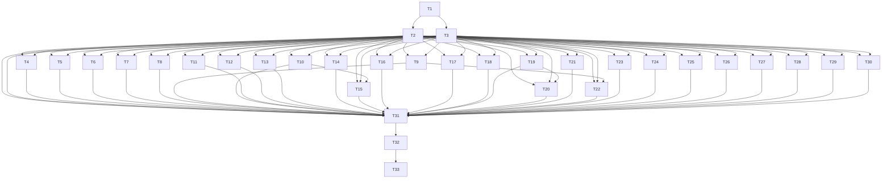

# 광역 결함 감사 후속 수정 PRD · RPG

작성/공식 문서 확인일: 2026-11-05 KST. tag `comprehensive-remediation` · planId `comprehensive-remediation-2026-11-05`.
SOURCE `C:\Users\user\Documents\ChatGPT\하루단어\work\comprehensive-defect-audit-20261105` · branch `codex/comprehensive-defect-audit-20261105` · HEAD `5609a8e6fa7d148ff4cf6582ae20fe0ed2669171`.
현재 범위는 계획 작성·작업 등록·대시보드 연결·계획 검증이다. 모든 구현 작업은 pending이다.

<overview>
## Problem Statement
계정 전환과 학습 복구가 저장 전 초안 또는 독립 성적을 삭제할 수 있고, 입력·AI 계약·검사 도구·복구 문서·의존성 경계에 누락이 있다. 감사32영역/943파일에서 결함22(제품12/도구·운영·문서10), 별도 의존성7정비(고유23권고)가 확인됐다. 원래 P1 2/P2 17/P3 3은 결함22건 기준이며 의존성 정비의 우선순위와 합산하지 않는다.
## Target Users
여러 탭/계정을 쓰거나 네트워크·기기 저장소가 불안정한 학습자, 문법 보완 후 독립 복습을 이어가는 학습자, QA/복구/게시를 담당하는 관리자.
## Success Metrics
계획: 29/29가 독립 숫자 작업/세부 ID에 연결되고 없는 참조·순환·허위 완료0, 기존3태그 및 감사/닫힌 평가 변경0,4플랜 선택/원본 수 일치. 제품 성공은 후속 구현의 각 항목 negative/positive 회귀와 실제 저장/재로드 및 통합 게이트 통과로 별도 판정한다. 등록은 제품 성공이 아니다.
</overview>

<functional-decomposition>
## Capability Tree
기능 보장(WHAT)을 구조(HOW)와 분리한다. 공통 입력은 해당 행 trigger, 출력은 expected, 동작은 아래 계약이다. 원인·기대·파일·증거·제한을 항목별로 보존한다.
### UI-5 · P1 · Task #2
- 입력: 같은 origin의 두 탭. A 인증으로 받은 SSR 문서를 지연시킨 사이 현재 인증이 B로 바뀌고 B가 실제 문법 입력을 기기에 보관한다. 이후 A 문서를 전달하여 hydration한다.
- 출력/보장: 새로 mount하는 과거 owner는 현재 인증/소유권이 확인되기 전에 다른 owner의 기기 row를 제거하거나 owner marker를 되돌리지 않아야 한다.
- 현재 관찰: fresh 계정으로 두 차례(012/013) 동일 재현. B의 정상 기기 초안 row1/ownerB가 A mount 뒤 row0/ownerA로 바뀐다. 늦은 A의 state GET은401로 정상 차단되지만 기기 row는 이미 삭제되었다.
- 동작/최소 방향: 현재 인증 확인 이전 connect는 타 owner 정리·marker 변경을 하지 않도록 명시 인증 전환 경계와 연결. 검증된 전환의 이전 입력 정리와 stale 재시도 거부는 유지.
- 성공 기준: A 지연 문서→B 인증/실제 미저장 입력→A hydration 순서에서 B row와 입력을 보존하고 A 요청401을 유지한다. 반대 전환·정상 로그인·명시 로그아웃·stale retry·페이지 복원·두 계정 owner marker도 함께 확인한다.
- 근거 수준: 실제 built Chromium·합성 D1, fresh 계정 2회 재현(012/013)
- 미검증: 운영 SSO/쿠키 전환은 로컬 QA 인증 헤더로 모사했다. 서버 계정 격리 우회/타 계정 읽기 증거는 아니다. | 010/011은 준비 단계 실패로 제외하며 012/013만 제품 재현 근거로 쓴다. | 운영 SSO 화면/쿠키 전환 자체는 검사하지 않았다. 승인된 로컬 QA 인증 헤더로 서버의 인증 변경을 모사했다. | 실제 브라우저가 증명한 것은 기기 row 삭제와 늦은 요청401이며 운영 발생 빈도나 모든 화면 메모리 상태의 최종 유실은 측정하지 않았다. | 실기기·실제 제공자 호출은0이다.

### AI-6 · P1 · Task #3
- 입력: 완료한 수업의 예약 복습을 두 번 독립 성공한 뒤 내 문장 보완에서 수정하거나 AI 교정을 적용한다.
- 출력/보장: 문장 자기점검을 갱신하더라도 별도로 측정한 객관식 재점검 결과·독립 성공/사용 세트 이력은 보존한다(GRAMMAR_PRACTICE_V2.md:18, FEEDBACK_RECHECK_AND_RECOVERY.md:9).
- 현재 관찰: v2/v3/v4 순수 함수·스키마 재현에 더해 built Chromium과 합성 D1에서도 문장 수정→원문 되돌리기→자기 점검·재완료 뒤 독립 복습 review/schedule이 삭제됐다. root007/014에서 같은 결과를 반복 확인했다.
- 동작/최소 방향: 기존 completedAt을 최초 수업 이력으로 보존하면서 stage5의 새 문장 자기점검 필요성을 별도로 판정하는 최소 변경을 우선 검토. completedAt 유무만으로 새 문장을 완료 처리하는 UI/스키마를 함께 조정. review/schedule 삭제나 새 DB 스키마로 우회하지 말고 v1~v4 reader/save roundtrip 확인.
- 성공 기준: v2/v3/v4의2회 독립 성공→쓰기 열기→수동수정/AI적용/되돌리기→저장/재로드/재완료에서 최근 review·passed·used 보존. 새 자기점검은 요구. UI-4의 복구 시 completedAt/check 불일치와는 별도 경로.
- 근거 수준: 실제 built Chromium·합성 D1 2회(007/014) + v2/v3/v4 순수 함수·스키마 2회
- 미검증: v2/v3도 순수 함수·스키마로 검사했으며 실제 UI/D1 반복은 v4다. 운영 학습 행이나 실제 iPhone은 검사하지 않았다. | 문장 자기 점검을 무효화하는 정상 요구와 독립 객관식 복습 성적의 삭제를 구분했다. review/schedule을 그대로 두고 completedAt만 지우는 변경도 현행 스키마를 위반할 수 있다.

### UI-3 · P2 · Task #4
- 입력: 브라우저 기기 보관을 거부한 합성 계정에서 문법 쓰기를 열고 revision 충돌을 만든다.; 최신 기록 불러오기를 승인하고 GET 응답을 보류한다. 닫힌 확인창 뒤의 문장 textarea에 새 입력을 쓴다.; GET을 성공시키면 current의 새 입력이 이전 서버 문장으로 교체되고 epoch가 증가한다.
- 출력/보장: 재조회 확인을 누른 뒤에도 화면이 허용해 받은 새 입력은 보존하거나, 교체 중 입력을 명확히 잠가야 한다. 저장소 거부 시에도 화면 입력 보호가 필요하다.
- 현재 관찰: localStorage 거부→유효한 PUT409 응답 주입→사용자 최신 기록 불러오기 확인 뒤 실제 GET200을 지연했다. 그동안 새 입력을 수락했지만 GET 적용/epoch remount 뒤 재진입한 입력창·실제 D1·원래 native storage 모두 새 입력이 없었다(032/033).
- 동작/최소 방향: 일반 저장과 구별한 snapshot replacement 진행 플래그를 기존 store에서 문법 쓰기까지 전달하여 해당 구간만 편집 잠금. 시작 전 draft 백업/보존 및 실패 후 잠금 해제 확인. 유효 합성409 주입과 실제 D1 GET 관찰을 분리.
- 성공 기준: localStorage unavailable과 quota 초과 각각에서 지연된 최신 기록 GET 동안 입력을 시도한다. 입력이 잠기거나 응답 뒤에도 새 입력이 명시적으로 보존되는지, reload/restore epoch 이후까지 검증한다.
- 근거 수준: 실제 built Chromium·합성 D1·기기 backing storage 반복 2회
- 미검증: 기기 저장 거부와 사용자가 명시적으로 확인한 최신 기록 재조회가 함께 필요한 조건이다. 확인 전 기존 입력의 폐기가 아니라 확인 뒤 새로 수락한 입력의 손실을 검사했다. | 충돌409는 커밋 없이 현행 형식의 합성 응답을 주입했다. built 입력창·D1 seed/GET200·최종 D1/기기 관찰은 실제 로컬 경계다. | 030/031은 재현 준비·화면 재진입 관찰이 끝나지 않은 시도이며 최종 증거는032/033이다. 운영 빈도·실기기는 미검증이다.

### UI-1 · P2 · Task #5
- 입력: 합성 같은 회차/entry/en question을 두 탭에서 연다. A에 공개 전 입력 변형을 남긴다.; B에서 빈 답으로 정답을 공개해 hinted/revealed=true를 저장한다. 최신 snapshot을 연 탭에서 A의 다른 입력을 비교 후 복구한다.; 복구된 화면에서 정답을 적고 다시 공개한다. 도움 없는 성공 버튼이 활성화된다.
- 출력/보장: 답을 이미 공개한 같은 question에서는 첫 답과 도움 사용을 보존해야 한다. 복구는 채점이나 회상 성과를 바꾸지 않아야 한다(복구 정책 및 RecallStage readOnly/hint gate).
- 현재 관찰: 실제 앱에서 답·도움을 공개한 뒤 이전 변형 초안을 선택하면 hinted/revealed가 false로 내려가 독립 성공 버튼이 활성화된다. 다음 저장의 실제 D1에서 en=independent, hintEn=false를 확인했다(025/026).
- 동작/최소 방향: 같은 question의 revealed/hinted는 현재/서버/후보의 OR로 보존하고 first 답은 최초 기록을 유지. 편집 문장만 복구. undo에도 같은 규칙. 단어 친숙도/일일 목표/문법 성적과 합치지 않음.
- 성공 기준: 두 탭의 공개 전/후 변형 비교 복구와 복구 되돌리기를 수행한다. revealed/hint가 낮아지지 않고 원래 답이 보존되며 독립 성공이 잠긴 상태를 검증한다. 실제 React/브라우저와 저장 API까지 연결한다.
- 근거 수준: 실제 built Chromium·합성 D1 반복 2회 + 제품 hook 경계 재현
- 미검증: 운영 발생 빈도는 측정하지 않았다. 024는 저장 진행 중 다음 조작을 한 재현 준비 실패이며 근거에서 제외했다.

### UI-2 · P2 · Task #6
- 입력: 합성 계정에서 sentence 단계 입력을 한 뒤 문장을 완성하고 저장 성공을 기다린다.; 다음 회차/다음 question에서 같은 흐름을21회 반복한다.; local draft store에는 완료 question의20개 row가 남고 21번째 기기 보관은 capacity로 거절된다.
- 출력/보장: 실제 승인된 snapshot과 일치하는 해당 초안은 저장 성공 뒤 정리하고, 실패한 입력/다른 탭의 변형은 남겨야 한다.
- 현재 관찰: 정상 practice 문장 세션21항목을 실제 앱에서 차례로 완료·저장했다. 합성 D1에21개 완료 문장이 있어도 기기에는 이전 완료 초안20개가 남고 새 복구 row 저장이 capacity로 차단됐다(028/029).
- 동작/최소 방향: 전송 시 owner/instance/question/fingerprint를 캡처해 성공 응답 시 동일 row만 compare-and-remove. 더 최신 변형·다른 탭·실패 row는 유지. UI-5 owner 세대 경계 안에서만 정리.
- 성공 기준: 성공→question 전환은 row 제거, 실패→전환은 row 유지, 늦은 성공→더 최신 변형 유지,20개 초과 정상 완료 후 새 draft/AI UUID 저장 가능을 실제 hook/브라우저로 확인한다.
- 근거 수준: 실제 built Chromium·합성 D1에서 정상 저장21건/잔여 초안20개/한도 거절 2회
- 미검증: 일일 목표20 제한을 넘긴 daily 세션이 아니라 스키마가 허용하는 practice 세션21개를 사용했다. | 027은 안내문 두 개를 고유 선택하지 못한 재현 준비 오류이며 제품 근거에서 제외했다. 운영 장기 발생 빈도는 미측정이다.

### UI-4 · P2 · Task #7
- 입력: 합성 완료 문법 수업에서 내 문장 보완을 눌러 stage5에 진입한다.; 같은 lesson/contentVersion/쓰기 question의 다른 탭에 남은 미완료 문장 변형(check 없음)을 비교 후 복구한다.; 복구 snapshot을 제품 grammarProgressSchema로 확인하면 문장과 자기 점검 오류가 발생한다.
- 출력/보장: 유효한 쓰기 초안을 선택하면 저장 가능한 grammar progress가 되어야 한다. 문장 변경은 정상 updateGrammarSentence의 완료/자기점검 재확인 계약과 일치해야 한다.
- 현재 관찰: 완료 수업에서 내 문장 보완을 연 뒤 미완료 문장 초안을 선택하면 completedAt은 유지되고 check/checks는 사라진다. 실제 built 앱의 자동 저장이400으로 거절됐다(008/015).
- 동작/최소 방향: AI-6의 수정된 문장 변경 함수를 먼저 확립한 후 사용. 현재 updateGrammarSentence 그대로 재사용 금지. 복구 check/frame 유효성 및 같은 문장 복구의 무변경 보존을 검증.
- 성공 기준: 완료 수업→쓰기 보완에서 다른 탭의 sentence-only draft를 복구하고 autosave/leave 성공과 schema validity를 확인한다. AI-6의 두 차례 독립 성공·최근 재점검·예약 세트가 복구/보완/재완료 뒤 보존되는지 함께 검증한다. 같은 문장·자기점검 포함 변형 및 신규 수업 복구도 비교한다.
- 근거 수준: 실제 built Chromium·합성 D1에서 autosave400 반복 2회 + 스키마 대조
- 미검증: 현행 updateGrammarSentence를 그대로 재사용하면 AI-6의 독립 복습 이력 삭제를 도입한다. AI-6의 올바른 공통 전이 수정이 선행해야 한다. | 실제 유료 모델·운영 DB·실기기는 사용하지 않았다.

### AI-1 · P2 · Task #8
- 입력: 문법 쓰기에 앞뒤 공백이 있는 문장을 저장하고 v5 AI 참고 의견을 요청한다.
- 출력/보장: 요청 수락과 저장의 원문 동일성 규칙을 일치시켜 원문 공백을 보존하면서 해당 정상 의견을 저장한다.
- 현재 관찰: 앞뒤 공백이 있는 원문은 입력창에 그대로 남고 정상 형식의 주입 의견 original은 trim된다. UI는 의견을 수락하지만 실제 진도 자동 저장은 원문 불일치로400이 됐다(009/016).
- 동작/최소 방향: 기존 feedback-input 원문 일치 함수를 model 저장 검증에도 적용. 앞뒤 SPACE/TAB/LF/NBSP만 허용하고 structured-v1 raw 원문·내부 공백 거절 유지.
- 성공 기준: SPACE/TAB+LF/NBSP 원문→실제 생성 파서→복구→grammarState/saveSchema 및 저장 성공까지 확인. 내부 공백/다른 문장은 계속 거절. structured-v1 raw 원문은 보존.
- 근거 수준: 실제 built Chromium·합성 D1·현행 모의 OpenAI 응답 반복 2회
- 미검증: OpenAI 응답은 현재 계약에 맞춘 모의 응답이다. 실제 유료 모델 품질·운영 저장은 검사하지 않았다.

### AI-2 · P2 · Task #9
- 입력: AI POST 응답이 유실된 뒤 이전 결과 GET 중 DB 일시 장애 등으로 receipt 없는 503을 받는다.
- 출력/보장: GET 자체 실패와 영수증이 확인한 failed/expired/unknown을 구분한다. 일시적 조회 실패에는 pending UUID를 유지해 다음 클릭도 조회한다.
- 현재 관찰: 첫 POST send1 → 조회503/receipt없음 → 로컬 pending을 failed로 변경 → 다음 명시 클릭은 기존 UUID 조회 대신 다른 UUID로 send2. 실제 GET route의 주입 DB 오류도 동일503/receipt없음을 생성한다.
- 동작/최소 방향: 동일 requestId의 유효 종결 receipt만 acknowledge. receipt 없는 503/502/429는 pending. 401은 인증 UI 차단과 별도 검증. unknown/expired/invalidated의 기존 계약 및 명시 재시도 안내를 보존.
- 성공 기준: 응답 유실→실제 GET503/receipt없음→다음 명시 클릭은 같은 UUID GET이며 새 POST가 없어야 한다. 502/429는 파서 경계에서 pending UUID 보존을 확인한다. 401은 인증 UI의 재요청 차단을 별도 확인하고 같은 추가 전송 도달성으로 해석하지 않는다. 명시 failed/unknown/expired/invalidated 영수증 계약은 유지한다.
- 근거 수준: 실제 복구 경계 오프라인 재현 2회 + 실제 GET route의 합성 DB 오류503 연결
- 미검증: 실제로 연결한 오류는 DB 일시 장애의 receipt 없는503이다. 401에서는 인증 UI가 다음 요청을 막을 수 있으므로 같은 사용자 도달성/추가 전송을 주장하지 않는다. | 502/429 등은 복구 파서의 같은 분류 경로에 대한 후속 회귀 제안이다. 실제 과금·운영 중복 호출은 입증하지 않았다.

### DATA-1 · P2 · Task #10
- 입력: 기존 합성 resource-probe.cjs의 huge 모드: 인증 경계는 합성 소유자로 고정하고 DB 경계는 접근 시 예외 처리한 실제 PUT /api/state 번들. 첫 카탈로그 항목의 studyDates에 숫자 800000개를 담은 요청은 1600077바이트로 1800000바이트 상한 이하다.
- 출력/보장: 컬렉션 개수/구조를 과도한 열거·스키마 항목별 파싱·오류 할당 이전에 제한하여 정상적인400을 반환한다.
- 현재 관찰: 기존 프로젝트 heap-limit.cjs를 적용한 독립 Miniflare/workerd(old space96MB, semi space4MB)에서 JavaScript heap out of memory fatal 및 TypeError: fetch failed. 원장 capture004의 producer는 complete, 자식 exit2, timeout 아님. 같은 Worker 경계에서 숫자10개(97B)와240000개(480077B)의 저장은400, 직접 복원240000개(480144B)도 구조 한도 오류400이었다.
- 동작/최소 방향: state-shape/backup-structure의 기존 한도를 참고해 열거 이전 shallow 길이/컬렉션 수를 제한. 작은 안전 fixture로 선행 거절 경로부터 검증. 이번 계획에서 OOM/부하 재현 금지. fatal 정확한 단계·반복성·운영128MB는 미검증 유지.
- 성공 기준: 후속 격리 검증에서 잘못된 대형 컬렉션이 400으로 끝나고 Worker가 살아 있으며 DB/revision이 변하지 않는지 검증한다. 유효 경계·예약 뜻 키·복원 호환성도 보존한다.
- 근거 수준: 제한된 전용 로컬 Miniflare/workerd 실패 1회 + 작은 요청 대조; 추가 부하 재현 중단
- 미검증: old-space96MB/semi-space4MB 전용 로컬 Worker의 fatal1회다. 운영128MB isolate의 재현성·전역 장애·다른 계정 영향은 미검증이다. | Object.entries 열거와 Zod 항목별 파싱/오류 할당 중 정확한 fatal 단계는 계측하지 않았다. DEP-ZOD를 확정 직접 원인으로 귀속하지 않는다. | 보안 우려가 제기돼 첫 로컬 실패 뒤 추가 비정상 대형 입력·메모리 고갈 검사를 중단했다. 실제 도구의 자동 거절 원문은 확인되지 않아 도구가 차단했다고 단정하지 않는다. 기존 정상 백업 성능 회귀와 구분한다.

### DOCS-1 · P2 · Task #11
- 입력: README.md:109의 ‘저장·구형 호환·복구 지침’ 링크를 따라 AI_SENTENCE_STRUCTURE.md를 읽고, 장애 시 문서:54의 google_ai_enabled=false만 적용한다. 이번 감사에서는 환경 변경·재게시·실제 호출을 수행하지 않았다.
- 출력/보장: README에서 직접 연결하는 복구 지침은 현행 스위치 ai_feedback_enabled=false를 안내하거나 과거 구조 기능 이력임을 명시하고 현행 복구 문서로 연결해야 한다. 새 OpenAI 기록과 호환되는 reader/백업 보호도 유지해야 한다.
- 현재 관찰: 문서:54는 google_ai_enabled=false를 AI 요청 중단 방법으로 지시한다. 문서 첫머리나 복구 절에는 과거 기록 경고 또는 현행 OpenAI 복구 문서로의 재지정이 없다. 현재 sentence route:21은 env.ai_feedback_enabled만 검사하고 grammar route:38도 grammar_enabled 및 ai_feedback_enabled를 검사한다. 현행 docs/OPENAI_FEEDBACK.md:50은 ai_feedback_enabled=false를 명시한다.
- 동작/최소 방향: 원문 과거 구조 설명은 보존하고 현재 복구 절/문서 첫머리/README 링크를 명시적으로 정정. 추가 제공자 호출·옛 스위치 활성화 없음.
- 성공 기준: README의 현행 실행/복구 링크를 따라 현재 AI 스위치 및 호환 reader 유지 지시가 실제 route/운영 문서와 일치하는지 확인한다.
- 근거 수준: README 링크·복구 원문·현재 두 AI route 조건의 직접 정적 대조
- 미검증: 현재 안내와 현재 route 조건의 직접 모순이다. 실제 운영 토글·배포·추가 비용 발생은 관찰하지 않았다. 과거 릴리스의 시점 차이 자체는 결함으로 세지 않았다.

### OPS-1 · P2 · Task #12
- 입력: OPERATIONS.md:341의 공식 생성 순서에서 기존 scripts/prepare-attribution.py를 실행하는 정상 유지보수 경로. 이번 감사에서는 실행하지 않았다.
- 출력/보장: 출력과 생성기 양쪽의 현재 전송정책이 일치해 문서화된 재생성이 수정사항을 보존해야 한다.
- 현재 관찰: 현재 public/sources/content-attribution.txt:60~63은 OpenAI Responses 전용/명시 요청/Google·Groq 자동전환 없음이다. 생성기 credits:72~75는 Google 우선, 실패 시 Groq 자동전환, 두 서비스 Free 계정을 안내하고:77에서 같은 공개파일에 무조건 write_text한다. 상위 운영문서:341/:565가 이 생성기를 계속 안내한다.
- 동작/최소 방향: 기존 생성기 credits 문자열을 현재 공개 정책으로 맞추고 합성 임시 출력 대상에서 재생성 검사. 새 추상화나 제공자 실행 코드는 추가하지 않음.
- 성공 기준: 합성 임시 경로에서 생성한 공개 안내가 OpenAI Responses/명시 요청/자동전환없음을 유지하는 회귀 검사.
- 근거 수준: 생성 템플릿·현재 공개 산출물·공식 실행 안내의 직접 정적 대조
- 미검증: 현재 배포 공개 파일 자체는 올바르다. 공식 재생성 경로의 회귀 가능성을 원문으로 확인했으며 생성기를 이번에 실행하지 않았다.

### DEP-UNDICI · P2 · Task #13
- 입력: Agent의 tls 옵션에 사용자 정의 checkServerIdentity 등 함수 콜백을 두고 기본 TLS 검증보다 강한 정책에 의존해야 한다. connect 옵션 경로는 구분한다. / undici EventSource 클라이언트가 외부 SSE 피어를 유지할 때 필드/미완성 라인 누적 또는 압축 후 메모리 증폭이 가능하다. / origin 없는 Agent + shared cache + redirect 후 cache 순서의 interceptor 조합이 필요하다. origin 고정 Pool/Client와 반대 순서는 구분한다. / decompress interceptor와 dump 또는 예외를 던지는 downstream handler를 합성하고 악성 압축 응답을 받아야 한다. / undici WebSocket 클라이언트가 응답을 읽지 않으며 PING을 보내는 악성 피어에 연결되어야 한다. / fetch integrity에 유효한 대문자/혼합 대소문자 알고리즘 토큰을 쓰고 응답 본문을 공격자가 제어할 때 SRI 검사를 건너뛴다. / 연결한 HTTPS 피어가 TLS 1.2 재협상에서 호스트명이 다른 신뢰 체인 인증서로 교체해야 한다. TLS 1.3은 이 재협상 조건과 다르다. / 연결한 HTTP 피어가 과도한 content-coding 응답과 본문 조기 종료를 만들어야 한다. fetch rejection의 catch만으로 이 orphan stream 오류를 막을 수 없다는 권고다.
- 출력/보장: 권고 수정 버전/수정된 상위 배포본을 호환성 검토하고 설치된 모든 해당 copy의 해석·번들 상태를 확인한다.
- 현재 관찰: Miniflare Node 개발/로컬 프록시 및 Wrangler Node 개발·배포 도구. Wrangler CLI의 require_undici()를 통한 HTTPS fetch 호출이 정적으로 존재한다. 앱 OpenAI는 workerd의 전역 fetch를 기본 주입하며 해당 Node 패키지를 import하지 않는다. 기존 dist/server의 JavaScript 118개에서 undici 패키지 import/require 서명 0. workerd 네이티브 HTTP/WebSocket 구현은 이 npm 패키지 버전과 별개다. 별도 로컬 Node22.22.2 내장 Undici6.24.1은8개 중5개 버전 범위에 해당한다. Node24.22.1 내장7.30.1은 이8개 범위 밖이다. npm override로 Node 내장이나 Wrangler 사전 번들은 바뀌지 않는다.
- 동작/최소 방향: 8개 권고 각각 fixed range와 소비자 해석을 구현 당시 공식 advisory로 재확인. 기존 npm/lockfile 유지. Wrangler 내장 copy 및 Node 내장은 별도 확인하며 필요 최소 호환 패치만 선택.
- 성공 기준: Miniflare의 외부 undici와 Wrangler 내장 copy를 각각 확인하고 기존 로컬 Worker/QA/빌드 동작을 검증한다. Node 내장 fetch/WebSocket을 npm override 결과와 분리한다.
- 근거 수준: 공식 권고·lock/실제 설치 copy·소비자 코드·기존 Worker 산출물 정적 대조
- 미검증: 악성 피어·프로토콜 응답·TLS·SSE·압축·SRI·WebSocket 검증을 실행하지 않았다. 툴체인이 도달 가능한 임의 공격자 피어 또는 실제 악용은 입증하지 않았다. | 악용·네트워크/브라우저·대량 입력·새 설치·새 빌드0. 정비 우선순위는 앱 도달성을 반영하며 advisorySeverity와 다를 수 있다. | 로컬 Node 패치 버전과 CI의 major 선언을 구분한다. 운영 workerd fetch를 Node의 Undici와 동일시하지 않는다. 이번 Node24 단위 결과는 별도 gates에 기록한다.

### DEP-VITE · P2 · Task #14
- 입력: Windows의 경로 및 line/column 제거 해석 차이로 존재 검사 우회가 가능하며 percent escaping 결함과 결합할 수 있다. / Windows shell로 전달하는 인자에 percent escaping이 빠진다. 원 권고의 파일 배치 및 환경/ADS 조건과 존재 검사 우회 연계를 구분해야 한다. / 변경되지 않은 브라우저 요청 URL을 transformIndexHtml에 전달하는 custom/middleware 흐름, inline module script, 그 페이지의 민감 정보/중요 동작이 함께 필요하다. / 일부 편집기 CLI 옵션 해석과 공격자가 놓은 파일/디렉터리 이름 및 경로 조건이 필요하다. 현재 middleware 계열은 일반적으로 WSL 조건을 추가로 구분해야 한다. / Windows가 아닌 네트워크 노출 개발 서버에서 root 상대 import URL이 읽을 수 있는 실제 호스트 절대 파일과 겹치고 fs.deny가 차단하지 않아야 한다.
- 출력/보장: 권고 수정 버전/수정된 상위 배포본을 호환성 검토하고 설치된 모든 해당 copy의 해석·번들 상태를 확인한다.
- 현재 관찰: npm dev/build는 scripts/run-framework.mjs에서 Vinext/Vite CLI를 사용한다. 배포 Worker는 Vite 개발 서버가 아니다. portable 설정의 host는 기본값이며 managed-linux 분기는 0.0.0.0/terminal.local을 설정한다. 현재 실행 프로필·활성 서버/편집기 상태는 새로 실행·조회하지 않았다. 기존 Worker JavaScript 118개에서 launch-editor-middleware/__open-in-editor/escapeCmdArgs 서명 0.
- 동작/최소 방향: 감사 당시 제안8.1.6은 후보이며 구현 당시 공식 fixed range 재확인. Vite 단독/상위 호환 여부를 확인한 최소 패치. portable 루프백·기존 플러그인 보존.
- 성공 기준: Vinext/Cloudflare 통합의 공식 빌드·기존 QA·portable loopback 실행 계약과 편집기 비활성/허용 경계를 확인한다. 개발 서버 검증을 배포 Worker 검증으로 일반화하지 않는다.
- 근거 수준: 공식 권고·lock/실제 설치 copy·소비자 코드·기존 Worker 산출물 정적 대조
- 미검증: 편집기 경로, 환경변수, ADS, 파일 우회, 교차 출처 URL 또는 fs.allow 우회 입력을 실행하지 않았다. loopback 설정만으로 모든 브라우저 기원 공격이 차단된다고 주장하지 않는다. | 악용·네트워크/브라우저·대량 입력·새 설치·새 빌드0. 정비 우선순위는 앱 도달성을 반영하며 advisorySeverity와 다를 수 있다.

### DEP-ZOD · P2 · Task #15
- 입력: 과도한 컬렉션 및 실패 원소별 검증/issue 축적이 자원 고갈을 일으킬 수 있다는 권고다. 버전 범위와 실제 구현/애플리케이션의 선행 제한을 함께 봐야 한다.
- 출력/보장: 권고 수정 버전/수정된 상위 배포본을 호환성 검토하고 설치된 모든 해당 copy의 해석·번들 상태를 확인한다.
- 현재 관찰: 저장·복원·AI 등의 스키마 검증에 직접 사용하며 Worker에도 ZodArray 코드가 존재한다. v3 ZodArray는 maxLength 위반을 기록한 뒤에도 입력 전체를 복사/map해 항목별 파싱한다. 이 패키지는 실제 Worker 검증 경로에 포함된다. PUT /api/state는 byte 한도/JSON parse/assertStateDataKeys 뒤 saveSchema.safeParse를 수행한다.
- 동작/최소 방향: DATA-1 사전 제한 완료 뒤 Zod major 필요성을 별도 검토. v3 유지의 완화책/잔여 advisory와 major 후보 호환 비교를 기록. 미충족이면 보류하고 일괄 최신화 금지. 제품 결함 추가0.
- 성공 기준: DATA-1의 선행 cardinality 제한을 별도로 검토한다. major 호환 검증은 과거·미래 모델/문법 기록·JSON/CSV·전체/분할 복원·revision 계약을 보존한다. 새 대량 입력/부하 재생은 현재 승인 범위에 없다.
- 근거 수준: 공식 권고·lock/실제 설치 copy·소비자 코드·기존 Worker 산출물 정적 대조
- 미검증: 공식 권고 설명의 $ZodArray/handleArrayResult(v4 계열)과 설치 v3의 코드를 동일 구현이라고 하지 않는다. DATA-1의 fatal이 Object.entries 단계인지 Zod 항목별 파싱/issue 생성 단계인지는 미계측. 운영 128MB isolate 실패, 타 계정 영향, 반복성은 입증하지 않았다. 대량 입력은 재실행하지 않았다. | 악용·네트워크/브라우저·대량 입력·새 설치·새 빌드0. 정비 우선순위는 앱 도달성을 반영하며 advisorySeverity와 다를 수 있다.

### AI-3 · P2 · Task #16
- 입력: 기본 일반 문장 형식에서 Cook./Dance./Jump./Sing./Swim. 등의 한 단어 명령문을 요청한다.
- 출력/보장: 실제 명령문은 유효하다는 결정표 계약을 지킨다. 제한된 목록에 없다는 사실만으로 미완성 문장이라고 확정하지 않는다.
- 현재 관찰: 주입 wire는 natural·원문 유지지만 앱이 single_fragment로 판단하여 목표/문법을 모두 uncertain·교정비움으로 바꾼다. 같은 Cook!나 명시command 형식은 통과한다.
- 동작/최소 방향: 일반 단일 단어를 모두 단편으로 단정하지 않고 확인 가능한 제한 패턴만 보류. 정상 명령문과 명사 단편의 대조 fixture. 모델 프롬프트/유료 호출 변경 없음.
- 성공 기준: 동일한 natural wire로 Cook./Cook!/Go./Stop.와 command 형식을 비교하고 명사 단편의 필요한 보류도 유지한다.
- 근거 수준: 실제 입력·판정 파서에 고정 wire 주입, 오프라인 2회
- 미검증: 잘못된 보류는 고정된 natural wire를 앱이 바꾼 결과다. 실제 모델 품질·오류 빈도나 모든 명령문 지식의 완전성을 평가한 결과가 아니다.

### AI-4 · P2 · Task #17
- 입력: needs_work 주입 응답이 "She like tea."를 "Does she like tea?"로 바꾼다.
- 출력/보장: 문법 교정이 질문/진술의 의도를 바꾸지 않도록 두 방향의 명백한 변화를 보호한다.
- 현재 관찰: correctionConflict는 undefined이고 parseJudgmentFeedback가 제안을 반환한다. "She is happy."→"Is she happy?"도 통과한다. 반대 방향 ? 삭제는 speech_act로 거절한다.
- 동작/최소 방향: 기존 correctionConflict의 발화행위 검사를 대칭으로 보완. 모든 의미 동등성을 증명하는 새 parser를 도입하지 않음.
- 성공 기준: 평서→의문·의문→평서 모두 거절; 잘못된 의문 어순→동일 의문 의미의 수정 통과.
- 근거 수준: 실제 교정 guard·판정 파서에 고정 wire 주입, 오프라인 2회
- 미검증: 의도 변경을 가진 합성 응답이 guard를 통과함을 보였다. 실제 제공자의 해당 오류 발생 빈도·사용자 적용은 미측정이다.

### AI-5 · P2 · Task #18
- 입력: 잘못된 제공자 교정이 같은 숫자/부정 개수를 유지하면서 의미 연결을 바꾼다.
- 출력/보장: 보호한다고 명시한 수량/부정이 원래 대상·절에 연결되어 있는지 확인하고 부호를 보존한다. 동등성 근거가 부족한 교정은 보류한다.
- 현재 관찰: "She have 2 red bags and 3 blue bags."→"She has 3 red bags and 2 blue bags." 통과(영어 two/three도 동일). "She do not like tea but likes coffee."→"She likes tea but does not like coffee." 통과. -5→5도 통과한다.
- 동작/최소 방향: 기존 내용어 순서 정책 안에서 수량 순서/부호와 부정 인접 절·내용어 앵커를 비교. 애매한 변환은 보류. 같은 절의 수일치 등 한정 예외를 positive control로 유지.
- 성공 기준: 수량 재배치·부호삭제·절간 부정이동 거절; 같은 절에서 does 수일치 교정은 허용. 기존 숫자 크기 변경·부정삭제 거절은 유지.
- 근거 수준: 실제 교정 guard·판정 파서 고정 wire 및 의미 연결 대조, 오프라인 반복
- 미검증: 합성 응답의 명백한 수량/부정 연결 손실을 확인했다. 일반 의미 동등성 전체 보장이나 실제 모델 오류 빈도에 대한 주장이 아니다.

### DASH-1 · P2 · Task #19
- 입력: 열린 대시보드를 유지한 채 dashboard-plans.json에 유효한 새 플랜을 등록하거나 기존 entry.label/context/budget을 갱신하고 자동poll/지금 새로고침을 사용한다. 이번에는 실제 원본 변경이나 새 플랜을 생성하지 않았다.
- 출력/보장: 현재 선택은 유지하더라도 registry의 플랜 목록/라벨/현재·이력 문맥·예산은 최신 응답을 반영해야 한다.
- 현재 관찰: catalog는:14의 const로 최초 HTML 자료에서만 고정된다. refresh는:244에서 planSnapshots만 교체하고 envelope.catalog는 적용하지 않는다. 선택버튼과 switchPlan 허용 목록은:43~62의 옛 catalog를 계속 쓴다. 또한 openai-dashboard-data.mjs:78의 source.hash는 rawTasks/rawManifest만 포함해 registry-only 변경에는 hash가 그대로이고:246의 renderPlans 등도 생략된다. 실제 브라우저에서도 유효한 새4번째 플랜 응답과 변경된 원본 hash를 받아도 선택지는3개였다. registry-only hash 미반영은 정적 확인 범위다.
- 동작/최소 방향: 향후 수정에서 catalog 검증/적용과 registry 지문을 함께 보완. 이번 등록에서는 reload로 새 HTML catalog를 읽고 알려진 stale-page 한계를 기록하며 이 코드는 수정하지 않음.
- 성공 기준: 기존 다중플랜 fixture에 유효한 새 플랜 추가 및 registry-only label/budget 변경을 적용한 뒤 새로고침/자동갱신에서 표시·선택·기존이력 보존 확인.
- 근거 수준: 실제 대시보드 JS/normalizer + 정상 모의 응답·지연 응답, built Chromium 반복 2회
- 미검증: 자체 루프백 서버와 메모리 응답을 사용했다. 기존4318·실제 Task Master/registry 원본은 수정하지 않았다. 현재 원본이 이미 혼합됐다는 주장이 아니다.

### DASH-2 · P2 · Task #20
- 입력: 자동/수동 refresh의 fetch가 진행 중인 동안 유효한 같은 플랜 JSON을 가져오고, 가져오기가 완료된 뒤 앞선 fetch 응답이 도착한다. 정적 완료순서 추적만 수행했다.
- 출력/보장: 사본 선택 뒤에는 이전 세대의 자동조회 응답을 버리고, 명시적인 live 재개만 최신 원본을 적용한다.
- 현재 관찰: :235의 imported 차단은 refresh 시작 때만 적용된다. :253~264의 import는 진행 중 요청을 취소하거나 세대를 바꾸지 않고 snapshot/imported 모드를 적용한다. 먼저 시작한 refresh는 응답 뒤:241~245에서 현재 같은 plan ID를 검증하고 무조건 snapshot=data; state.mode='live'를 실행한다. import 버튼도 fetching 중 잠기지 않는다. 실제 브라우저에서 가져온 사본과 imported 표시를 먼저 확인했지만, 이전 GET이 늦게 완료되면 live 표시와 원격 제목으로 되돌아갔다.
- 동작/최소 방향: 향후 import 시 기존 요청 세대 무효화 및 완료 시 모드/세대 확인. 정상 live 수동 복귀 계약 유지. 이번 등록 중 구현하지 않음.
- 성공 기준: 정상 응답을 지연시킨 상태에서 유효한 JSON 사본을 가져온 뒤 지연 응답을 완료해도 imported 모드와 사본 지문이 유지되는지 확인.
- 근거 수준: 실제 대시보드 JS/normalizer + 정상 모의 응답·지연 응답, built Chromium 반복 2회
- 미검증: 자체 루프백 서버와 메모리 응답을 사용했다. 기존4318·실제 Task Master/registry 원본은 수정하지 않았다. 현재 원본이 이미 혼합됐다는 주장이 아니다.

### DASH-3 · P2 · Task #21
- 입력: manifest는 judgment-remediation 또는 integration-remediation인데 읽은 Tasks JSON이 해당 태그 없이 구형 master의 bare {tasks:[...]} 형식인 경우. 구형 형식 자체는 유효하나 이 플랜에 귀속되지 않는다. 실제 원본은 바꾸지 않았다.
- 출력/보장: master의 구형 형식 호환은 유지하되 명명된 태그가 없는 다른 플랜에는 fallback하지 않고 missing_tasks로 원본 연결 오류를 반환한다.
- 현재 관찰: :29~30은 어떤 tag든 누락되면 tasksFile.tasks로 대체한다. :34는 플랜 task ID와 겹치는 항목을 선택하고 :35는 선택이0일 때만 거절한다. 세 실제 플랜은 모두1부터 시작하므로 master의 기존 작업들이 다른 플랜 제목/게이트 아래 나타날 수 있다. UI의 누락/개수 경고는 이미 다른 플랜 데이터를 채택한 뒤의 경고다. 반대로 dashboard.js:258의 파일 import는 bare 형식을 master 또는 일치 planId에만 허용한다. 실제 normalizer에 유효한 bare master 원본을 주면 integration-remediation 아래 master 제목이 채택됨을 확인했다.
- 동작/최소 방향: 향후 master 또는 명시 일치 planId만 legacy bare 허용. named tag 누락 시 fail-closed. Node normalizer 근거이며 브라우저 반복 재현으로 부풀리지 않음.
- 성공 기준: 기존 정상3태그와 master bare 형식은 허용하고, 이름 있는 플랜에 master bare 파일이 적용되지 않는지 의미 있는 출처 격리 회귀를 추가한다.
- 근거 수준: 실제 normalizer에 유효한 legacy 입력을 전달한 Node 오프라인 재현 2회(034/035); 브라우저 렌더링 재현은 아님
- 미검증: 구형 정상 bare master 입력을 Node의 실제 normalizer에 직접 전달했다. 브라우저에서 잘못된 플랜을 렌더링하는 경로까지 실행한 증거는 아니다. | 실제 Task Master 원본·registry·기존4318은 수정하지 않았다. 현재3태그 원본이 이미 혼합됐다는 주장이 아니다.

### TEST-1 · P2 · Task #22
- 입력: 정적 단계1: 위 세 route.fulfill JSON에서 receipt가 없는지 확인한다.; 정적 단계2: readFeedbackRecoveryResponse의 HTTP200 경로는 receipt parse 실패 시 line18에서 invalid_response를 반환하며 feedback 검사/attachment에 도달하지 않는다.; 정적 단계3: 세 테스트는 feedback가 없는지만 assert하고 그 뒤 late-response ignore 성공 문자열을 쓴다. 따라서 그 음성 결과는 stale 무시가 아닌 포맷 거절로도 똑같이 만들어진다.
- 출력/보장: 늦은 정상 응답을 무시한다고 보고하려면 같은 활성 요청에 즉시 도착했을 때 수락 가능한 응답을 지연시킨 뒤 무시 여부를 확인해야 한다.
- 현재 관찰: refactor-boundaries와 navigation의 지연 응답에는 receipt와 현행 OpenAI provenance가 없다. request-timeout의 지연 응답에도 receipt가 없다. readFeedbackRecoveryResponse는 HTTP200에서 completed receipt 없으면 stale 대상 검증/저장 이전에 invalid_response로 종료한다. 대상이 바뀌지 않은 정상 요청이어도 수락 불가능하므로 feedback===undefined라는 음성 assert는 그대로 통과한다.
- 동작/최소 방향: 기존 feedbackReceipt/currentOpenaiFeedback helper로 현행 receipt/provenance 사용. 동일 fixture 즉시 수락과 stale 거부를 둘 다 검사. 격리 변이로 guard 제거 시 실패 확인.
- 성공 기준: 정상 fixture의 즉시 응답은 저장됨을 확인하고, 동일 정상 fixture의 지연 응답은 무시됨을 확인한다. 관련 현재성/무효화 보호를 제거한 변이를 별도 격리 재생에서 실패시켜야 한다.
- 근거 수준: 현행 응답 계약·fixture/assertion 경로의 독립 정적 검토. 원래 사례는 전체 native suite에서 실행했고 전용 변이·정상 응답 fixture 재현은 미실시
- 미검증: 잘못된 fixture로는 stale-response 방어 퇴행을 판별하지 못한다는 결론이다. 실제 제품의 stale attachment 결함이나 다른 assertion 전체 무효를 주장하지 않는다. | 음성 assert의 근거가 무효하다는 정적 확인이다. 제품에 stale attachment 결함이 실제 존재한다고 새로 단정하지 않는다. | timeout의 잠금 해제/입력 보존/성적 보존과 navigation의 저장 실패 이탈 차단 등 다른 assertion은 이 결함과 별도로 유효할 수 있다. | 현재 generation/abort/owner 여러 보호가 중첩된다. 특정 한 줄 삭제만으로 실제 제품 오염이 발생한다고 주장하지 않는다.

### OPS-2 · P2 · Task #23
- 입력: Linux/macOS에서 browser performance suite의 backup-resource-qa.cjs가 isolatedWorker를 생성한 뒤 검사 timeout 또는 suite 중단에 걸리는 경우. 정적 순서 추적만 했으며 새 프로세스나 timeout 재현은 실행하지 않았다.
- 출력/보장: 자원 검사도 중단 메시지/신호에서 자신이 만든 Worker 종료 완료를 기다리거나, suite 소유 종료대상에 별도 Worker그룹까지 등록해야 한다.
- 현재 관찰: isolated-worker.cjs:15는 비Windows에서 detached:true로 Wrangler/Worker를 별도 프로세스 그룹으로 만든다. backup-resource-qa.cjs는 launchBrowser를 호출하지 않고 qa-stop/SIGTERM 처리기를 등록하지 않으며:33의 finally에만 worker.stop이 있다. runCase는 IPC연결이 있으면 qa-stop을 보내고(:16), 유예 뒤 검사 프로세스 그룹만 SIGKILL한다(:24). 분리된 Worker그룹은 그 대상에 포함되지 않으며 SIGKILL로 checker의 finally도 실행되지 않는다.
- 동작/최소 방향: 실제 Linux 환경의 합성 Worker 자식/포트로 timeout/SIGINT/SIGTERM·준비 중 중단을 확인. Windows 통과로 Linux 완료 표시 금지.
- 성공 기준: 기존 qa-interruption 스타일의 합성 Worker로 resource-checker 시작 중/실행 중 timeout·SIGINT/SIGTERM 후 Worker와 하위프로세스/포트0을 확인한다.
- 근거 수준: 프로세스 그룹·IPC·finally 종료 경로 정적 추적; orphan 실측 미실시
- 미검증: Linux/macOS 프로세스 그룹 의미에 따른 정적 결론이다. 실제 orphan·Windows 동일 현상·운영 Worker 장애를 확인한 결과는 아니다. | 운영 영향 없음: 로컬 QA 도구 경로만 해당 | 프로세스 그룹 결과는 플랫폼 의미와 코드에 따른 추론이며 실제 orphan 계측은 미실시

### DEP-SATORI · P3 · Task #24
- 입력: Satori가 제어되지 않은 값을 SVG로 렌더링하고 소비 방식이 위험한 경우가 전제다.
- 출력/보장: 권고 수정 버전/수정된 상위 배포본을 호환성 검토하고 설치된 모든 해당 copy의 해석·번들 상태를 확인한다.
- 현재 관찰: Vinext OG shim은 ImageResponse 생성자에서 @vercel/og를 지연 import한다. 현재 앱의 ImageResponse/next/og 사용은 0이다. 주 Worker만이 아니라 기존 Worker JavaScript 118개 전체에서 satori 호출/모듈 서명 및 ImageResponse 생성자 서명 0.
- 동작/최소 방향: 상위 Vinext/@vercel/og의 최소 호환 수정 릴리스 검토. 현재 미사용 OG/ImageResponse를 활성화하지 않음. fixed 범위와 미사용 도달성 기록.
- 성공 기준: 상위 Vinext/@vercel/og 호환성과 Worker 빌드 차이를 확인한다. 현재 미사용 ImageResponse/OG 경로를 새로 활성화하지 않는다.
- 근거 수준: 공식 권고·lock/실제 설치 copy·소비자 코드·기존 Worker 산출물 정적 대조
- 미검증: OG가 향후 활성화되거나 별도 렌더러에서 외부 입력을 SVG로 렌더링하면 조건이 달라진다. 생성 SVG 공격을 실행하지 않았다. | 악용·네트워크/브라우저·대량 입력·새 설치·새 빌드0. 정비 우선순위는 앱 도달성을 반영하며 advisorySeverity와 다를 수 있다.

### DEP-NEXT · P3 · Task #25
- 입력: glibc Linux에서 해당 Next Image Optimization의 상위 이미지 라이브러리 경로가 필요하다. 공식 우회는 Next가 실제 사용하는 sharp >=0.35.5이다. / Next App Router의 Cache Components/use cache 함수가 여러 typed array를 반환하는 조합이 필요하다. / Next App Router에 적어도 하나의 Server Action이 있어야 한다. Server Action 없는 앱/Pages Router는 구분한다.
- 출력/보장: 권고 수정 버전/수정된 상위 배포본을 호환성 검토하고 설치된 모든 해당 copy의 해석·번들 상태를 확인한다.
- 현재 관찰: 실행 main은 vinext/server/fetch-handler이며 앱의 next/headers/navigation 등은 Vinext shim으로 연결된다. 실행 명령은 next start가 아니다. app/lib/db 267개 파일에서 use cache/use server/cacheComponents/ImageResponse/next/server·next/dist import 서명 0. 기존 Worker JavaScript 118개에서 Next server runtime 경로 서명 0. Vinext 자체 image optimizer는 SVG 거절 또는 보안 헤더를 붙인 통과 응답 경로이며 Next의 sharp SVG 변환 경로와 구분된다.
- 동작/최소 방향: 공식 권고3개 fixed range·sharp 실제 소비자 해석을 재확인하고 호환되는 최소 패치. Next 서버 runtime 새 유입 금지. 운영 RCE 입증으로 쓰지 않음.
- 성공 기준: Vinext shim 해석·공식 Worker 빌드·SSR/저장/복원 기존 회귀를 확인하고 Next 서버 코드가 새로 유입되지 않았는지 대조한다. sharp의 실제 해석 버전을 소비자별 확인한다.
- 근거 수준: 공식 권고·lock/실제 설치 copy·소비자 코드·기존 Worker 산출물 정적 대조
- 미검증: Next 버전만으로 Vinext 자체의 모든 RSC/캐시/이미지 코드가 안전하다고 증명하지 않는다. 실제 RCE/Server Action/이미지 입력은 시험하지 않았다. | 악용·네트워크/브라우저·대량 입력·새 설치·새 빌드0. 정비 우선순위는 앱 도달성을 반영하며 advisorySeverity와 다를 수 있다.

### DEP-FASTURI · P3 · Task #26
- 입력: 기본값이 아닌 reference:suffix를 사용하고 authority 없는 참조의 첫 경로 요소에 colon을 둔 결과를 다시 URI로 해석해야 한다. / 인코딩된 scheme을 raw 문자열로 검사한 뒤 fast-uri normalize/resolve 결과를 링크로 렌더링·저장하거나 equality 허용 목록에 사용해야 한다. / fast-uri가 해석한 host로 정책을 검사한 뒤 WHATWG URL 등의 다른 해석기를 통해 요청/리다이렉트를 수행하는 신뢰 경계가 필요하다. / 사용자 상대 참조를 normalize/serialize한 뒤 resolve하거나 결과를 cache/dedupe/인가 키로 사용해야 한다.
- 출력/보장: 권고 수정 버전/수정된 상위 배포본을 호환성 검토하고 설치된 모든 해당 copy의 해석·번들 상태를 확인한다.
- 현재 관찰: Ajv runtime URI resolver가 fast-uri를 require한다. 앱/DB/lib 267개 파일에서 직접 fast-uri import 0. 앱의 호스트·scheme 허용 목록, 리다이렉트, 링크 렌더링, outbound fetch 라우팅에 fast-uri를 쓰는 경로를 발견하지 못했다. 기존 Worker JavaScript 118개에서 fast-uri 패키지 import/require 서명 0. package-lock의 dev 플래그만으로 운영 포함 여부를 판정하지 않았다.
- 동작/최소 방향: 전이 Ajv/fast-uri 최소 패치 후 schema-utils/webpack URI 해석 검사. 현재 앱 SSRF/XSS/인가 우회 입증 없음 유지.
- 성공 기준: Ajv/schema-utils/webpack 소비자의 스키마 URI 해석과 공식 빌드를 확인한다. 현재 앱 SSRF/XSS의 재현으로 표현하지 않는다.
- 근거 수준: 공식 권고·lock/실제 설치 copy·소비자 코드·기존 Worker 산출물 정적 대조
- 미검증: Ajv 내부 URI 처리 전체에 대해 라이브러리의 모든 입력을 증명한 것은 아니다. 공격 URI를 파싱·실행하거나 브라우저/네트워크 요청에 사용하지 않았다. | 악용·네트워크/브라우저·대량 입력·새 설치·새 빌드0. 정비 우선순위는 앱 도달성을 반영하며 advisorySeverity와 다를 수 있다.

### DEP-MINIMATCH · P3 · Task #27
- 입력: 공격자가 glob pattern을 제공하고 optimizationLevel>=2인 전처리에서 배열 증폭 및 2차 pairwise 비교가 일어나야 한다.
- 출력/보장: 권고 수정 버전/수정된 상위 배포본을 호환성 검토하고 설치된 모든 해당 copy의 해석·번들 상태를 확인한다.
- 현재 관찰: typescript-estree의 allowDefaultProject glob 검사에서 minimatch(filePath, pattern, {dot:true})를 호출한다. 설치 10.2.5 코드는 optimizationLevel 기본 1이며 문제 전처리 분기는 >=2일 때다. 확인한 호출은 해당 옵션을 올리지 않는다. 프로젝트 ESLint 설정에도 optimizationLevel 설정을 발견하지 못했다. 앱/DB/lib의 minimatch import와 기존 Worker의 minimatch import/문제 전처리 서명은 0.
- 동작/최소 방향: typescript-eslint 소비자의 최소 패치·lint 검사. 실제 기본값1/문제분기2와 공식 affected 범위 불일치를 기록. Worker DoS 확정 금지.
- 성공 기준: 상위 typescript-eslint/ESLint 호환성과 기존 lint 명령을 확인한다. 공식 affected 범위 불일치 및 optimizationLevel 기본값/실제 호출을 기록한다.
- 근거 수준: 공식 권고·lock/실제 설치 copy·소비자 코드·기존 Worker 산출물 정적 대조
- 미검증: npm/GitHub reviewed 범위는 >=7 <11.0.1이지만 maintainer advisory의 affected 필드는 10.2.6만 명시한다. 설치 10.2.5에도 관련 증폭 코드가 있으나 이 불일치만으로 오탐 또는 실제 공격 가능성을 확정하지 않는다. glob 입력/부하 시험 0. | 악용·네트워크/브라우저·대량 입력·새 설치·새 빌드0. 정비 우선순위는 앱 도달성을 반영하며 advisorySeverity와 다를 수 있다.

### OPS-3 · P3 · Task #28
- 입력: 죽은 PID가 든 동일 lock이 남은 상태에서 두 suite가 동시에 시작. 실행 재현은 하지 않았다.
- 출력/보장: stale 회수와 새 lease 획득을 단일 소유권 프로토콜로 직렬화하거나 현재 소유권이 바뀐 경우 삭제하지 않아야 한다.
- 현재 관찰: A/B가 모두:4에서 옛 PID를 읽고:6~7에서 ESRCH를 확인한 뒤 A가:8 unlink와:10 wx 생성을 완료한다. B는 이미 확인한 옛 PID를 근거로:8의 무조건 unlink를 실행해 A의 새 파일을 삭제하고:10 wx에 성공한다. release의:12 소유자 검사는 이미 시작된 두 suite를 차단하지 못한다.
- 동작/최소 방향: 기존 lock API를 유지하며 stale recovery 소유권을 원자적으로 확보. 재확인과 unlink 사이 TOCTOU도 보호. deterministic barrier로 두 contender interleave 확인.
- 성공 기준: 두 가상 contender가 동일 stale lease를 관찰한 뒤 첫 contender의 새 lock을 두 번째가 지울 수 없는지 검사한다. 기존 tests/qa-process.test.mjs:10~16은 live-owner/release 교체만 검사하며 이 acquire 완료순서를 다루지 않는다.
- 근거 수준: 동일 stale lease의 두 acquire 완료 순서 정적 추적; 동시 실행 미실시
- 미검증: 죽은 PID lock을 두 실행이 동시에 회수하는 제한된 완료 순서다. 실행 재현이나 정상 단일 실행의 실패 증거는 없다.

### TEST-2 · P3 · Task #29
- 입력: 변경하지 않은 sentence-structure-qa.cjs를 built Worker와 WebKit에서 실행한다.
- 출력/보장: 버튼의 context fingerprint 준비와 새 문법 의견의 실제 저장 완료를 기다린 뒤 해당 결과를 검증한다.
- 현재 관찰: 전체 검사017과 단독019는 즉시 isEnabled 검사에서 실패했다. 관찰용020에서는 그 단계를 지나도 새 의견의 debounce 저장 전에 기존 전역 저장됨 표시를 읽어 다음 D1 단언이 실패했다. 제품 코드를 바꾸지 않고 두 관찰 대기만 추가한021/022는 전체 사례를 통과했으며 새 의견의 D1 저장이 약559/678ms 뒤 확인됐다.
- 동작/최소 방향: 재시도 가능한 enabled 단언과 특정 PUT/새 D1 fingerprint 완료 대기. 고정 sleep/단언 삭제 금지. 원래 WebKit 실패는 이력 보존.
- 성공 기준: Chromium/WebKit에서 fingerprint 및 debounce 지연 조건을 주어 새 의견의 실제 저장·유산 구조 보존까지 검사하고, 실제 실패 시에는 계속 실패하는지 확인한다.
- 근거 수준: 원본 WebKit 실패2회와 in-memory 관찰 대기 진단 통과2회; 원본 검사/제품은 수정하지 않음
- 미검증: 진단 통과는 원본 검사 통과가 아니다. 원본 WebKit gate는 실패 상태로 남긴다. | 관찰 대기만 추가한 진단이며 수정 구현·커밋은 하지 않았다.

### TEST-3 · P3 · Task #30
- 입력: qa-interruption.test.mjs의 합성 Worker가 owned.json을 게시하는 동안 부모/runner가 준비 여부와 정리 정보를 읽는다.
- 출력/보장: 완전한 마커가 게시된 뒤 ready를 알리고, 준비 실패 때도 cleanup 자체의 파싱 예외가 선행 실패를 가리거나 소유 프로세스 정리 경로를 건너뛰지 않는다.
- 현재 관찰: Node24 전체046은799/800·exit1이며 SIGINT/profile-start의 finally65 JSON.parse에서 Unexpected end of JSON input으로 끝났다. 소스는 최종 경로 writeFileSync25→existsSync42→ready30→무보호 parse56/65이고 완전한 JSON 게시 장벽이 없다. 독립 정적 검토도 이 경계 결함을 확인했다. 원본 단독048은6/6·exit0이었다.
- 동작/최소 방향: 임시 파일→동일 디렉터리 rename 또는 IPC 완전 marker로 준비 알림. 알려진 소유정보로 cleanup. EOF 최초 원인은 추론으로 유지하고 초기 오류/정리 오류 별도 기록.
- 성공 기준: 마커 게시를 지연한 조건에서도 완전한 JSON 전에는 ready가 나가지 않고, 준비 예외 시 최초 오류·소유 PID/포트/lock 정리 확인이 모두 남는지 검사한다. 원본 전체 Node22/24 게이트도 재검증한다.
- 근거 수준: 원본 Node24 전체 실패1회 + readiness/cleanup 정적 추적 + 독립 검토; 원본 단독 통과도 보존
- 미검증: 046 당시 marker 바이트와 선행 예외가 없어 그 실행의 최초 원인을 partial-write 경합으로 단정하지 않는다. 공유 준비 조건의 결함과 실제 finally 파싱 예외를 구분한다. | 실제 PID/포트/lock 유출이나 제품·운영 장애는 관찰하지 않았다. 단독 통과는 기존 실패를 취소하지 않는다.

</functional-decomposition>

<structural-decomposition>
## Repository Structure / Module Definitions
기존 React/TypeScript·Vinext/Cloudflare Workers·D1·npm lockfile을 유지한다. 아래 파일의 기존 함수/경계만 보완하고 전체 재작성·새 공통 추상화·일괄 최신화를 하지 않는다. 이번 계획 작성에서 이 구현 파일을 변경하지 않는다.

| 감사 ID | 기존 구조·파일 | 변경 경계 |
|---|---|---|
| UI-5 | lib/local-learning-drafts.ts:90 | 현재 인증 확인 이전 connect는 타 owner 정리·marker 변경을 하지 않도록 명시 인증 전환 경계와 연결. 검증된 전환의 이전 입력 정리와 stale 재시도 거부는 유지. |
| AI-6 | lib/grammar/model.ts:109 | lib/grammar/practice.ts:26 | app/grammar/grammar-lesson.tsx:74 | db/learning-state.ts:56 | 기존 completedAt을 최초 수업 이력으로 보존하면서 stage5의 새 문장 자기점검 필요성을 별도로 판정하는 최소 변경을 우선 검토. completedAt 유무만으로 새 문장을 완료 처리하는 UI/스키마를 함께 조정. review/schedule 삭제나 새 DB 스키마로 우회하지 말고 v1~v4 reader/save roundtrip 확인. |
| UI-3 | app/use-learning-store.ts:52 | app/grammar/grammar-writing.tsx:56 | app/grammar/use-grammar-draft.ts:43 | app/use-learning-store.ts:41 | app/learning-app.tsx:225 | app/learning-app.tsx:416 | 일반 저장과 구별한 snapshot replacement 진행 플래그를 기존 store에서 문법 쓰기까지 전달하여 해당 구간만 편집 잠금. 시작 전 draft 백업/보존 및 실패 후 잠금 해제 확인. 유효 합성409 주입과 실제 D1 GET 관찰을 분리. |
| UI-1 | app/study/use-study-draft.ts:33 | app/use-persistent-input.ts:72 | app/study/recall-stage.tsx:63 | app/study/use-study-session-controller.ts:111 | app/study/use-study-session-controller.ts:131 | docs/FEEDBACK_RECHECK_AND_RECOVERY.md:27 | 같은 question의 revealed/hinted는 현재/서버/후보의 OR로 보존하고 first 답은 최초 기록을 유지. 편집 문장만 복구. undo에도 같은 규칙. 단어 친숙도/일일 목표/문법 성적과 합치지 않음. |
| UI-2 | app/use-persistent-input.ts:59 | app/use-persistent-input.ts:26 | app/use-persistent-input.ts:57 | app/study/use-study-draft.ts:33 | lib/local-learning-drafts.ts:151 | 전송 시 owner/instance/question/fingerprint를 캡처해 성공 응답 시 동일 row만 compare-and-remove. 더 최신 변형·다른 탭·실패 row는 유지. UI-5 owner 세대 경계 안에서만 정리. |
| UI-4 | app/grammar/use-grammar-draft.ts:83 | app/grammar/grammar-summary.tsx:41 | lib/grammar/model.ts:106 | lib/grammar/model.ts:47 | AI-6의 수정된 문장 변경 함수를 먼저 확립한 후 사용. 현재 updateGrammarSentence 그대로 재사용 금지. 복구 check/frame 유효성 및 같은 문장 복구의 무변경 보존을 검증. |
| AI-1 | lib/grammar/model.ts:50 | lib/grammar/feedback-input.ts:8 | app/grammar/use-grammar-feedback.ts:63 | 기존 feedback-input 원문 일치 함수를 model 저장 검증에도 적용. 앞뒤 SPACE/TAB/LF/NBSP만 허용하고 structured-v1 raw 원문·내부 공백 거절 유지. |
| AI-2 | lib/feedback-recovery-response.ts:21 | lib/recoverable-feedback.ts:41 | app/api/feedback-requests/[id]/route.ts:18 | 동일 requestId의 유효 종결 receipt만 acknowledge. receipt 없는 503/502/429는 pending. 401은 인증 UI 차단과 별도 검증. unknown/expired/invalidated의 기존 계약 및 명시 재시도 안내를 보존. |
| DATA-1 | app/api/state/route.ts:66 | app/api/state/route.ts:73 | lib/state-data-keys.ts:12 | lib/state-shape.ts:40 | lib/backup-structure.ts:9 | lib/backup.ts:42 | lib/restore-validation.ts:25 | state-shape/backup-structure의 기존 한도를 참고해 열거 이전 shallow 길이/컬렉션 수를 제한. 작은 안전 fixture로 선행 거절 경로부터 검증. 이번 계획에서 OOM/부하 재현 금지. fatal 정확한 단계·반복성·운영128MB는 미검증 유지. |
| DOCS-1 | AI_SENTENCE_STRUCTURE.md:54 | 원문 과거 구조 설명은 보존하고 현재 복구 절/문서 첫머리/README 링크를 명시적으로 정정. 추가 제공자 호출·옛 스위치 활성화 없음. |
| OPS-1 | scripts/prepare-attribution.py:72 | 기존 생성기 credits 문자열을 현재 공개 정책으로 맞추고 합성 임시 출력 대상에서 재생성 검사. 새 추상화나 제공자 실행 코드는 추가하지 않음. |
| DEP-UNDICI | package.json:83 | node_modules/miniflare/package.json: | node_modules/miniflare/dist/src/index.js:89217 | node_modules/wrangler/wrangler-dist/cli.js:3812 | node_modules/wrangler/wrangler-dist/cli.js:32503 | node_modules/wrangler/wrangler-dist/cli.js:31838 | lib/openai-feedback.ts:79 | 8개 권고 각각 fixed range와 소비자 해석을 구현 당시 공식 advisory로 재확인. 기존 npm/lockfile 유지. Wrangler 내장 copy 및 Node 내장은 별도 확인하며 필요 최소 호환 패치만 선택. |
| DEP-VITE | package.json:11 | scripts/run-framework.mjs:21 | vite.config.ts:56 | node_modules/vite/dist/node/chunks/node.js:10360 | node_modules/vite/dist/node/chunks/node.js:26448 | 감사 당시 제안8.1.6은 후보이며 구현 당시 공식 fixed range 재확인. Vite 단독/상위 호환 여부를 확인한 최소 패치. portable 루프백·기존 플러그인 보존. |
| DEP-ZOD | app/api/state/route.ts:64 | app/api/state/route.ts:66 | app/api/state/route.ts:73 | lib/state-data-keys.ts:12 | lib/state-shape.ts:40 | node_modules/zod/v3/types.js:1787 | DATA-1 사전 제한 완료 뒤 Zod major 필요성을 별도 검토. v3 유지의 완화책/잔여 advisory와 major 후보 호환 비교를 기록. 미충족이면 보류하고 일괄 최신화 금지. 제품 결함 추가0. |
| AI-3 | lib/judgment-input.ts:3 | lib/judgment-input.ts:11 | lib/judgment-feedback-contract.ts:59 | 일반 단일 단어를 모두 단편으로 단정하지 않고 확인 가능한 제한 패턴만 보류. 정상 명령문과 명사 단편의 대조 fixture. 모델 프롬프트/유료 호출 변경 없음. |
| AI-4 | lib/judgment-correction.ts:49 | lib/judgment-feedback-contract.ts:72 | 기존 correctionConflict의 발화행위 검사를 대칭으로 보완. 모든 의미 동등성을 증명하는 새 parser를 도입하지 않음. |
| AI-5 | lib/judgment-correction.ts:5 | lib/judgment-correction.ts:10 | lib/judgment-correction.ts:39 | 기존 내용어 순서 정책 안에서 수량 순서/부호와 부정 인접 절·내용어 앵커를 비교. 애매한 변환은 보류. 같은 절의 수일치 등 한정 예외를 positive control로 유지. |
| DASH-1 | .taskmaster/dashboard/dashboard.js:244 | 향후 수정에서 catalog 검증/적용과 registry 지문을 함께 보완. 이번 등록에서는 reload로 새 HTML catalog를 읽고 알려진 stale-page 한계를 기록하며 이 코드는 수정하지 않음. |
| DASH-2 | .taskmaster/dashboard/dashboard.js:245 | 향후 import 시 기존 요청 세대 무효화 및 완료 시 모드/세대 확인. 정상 live 수동 복귀 계약 유지. 이번 등록 중 구현하지 않음. |
| DASH-3 | .taskmaster/scripts/openai-dashboard-data.mjs:30 | 향후 master 또는 명시 일치 planId만 legacy bare 허용. named tag 누락 시 fail-closed. Node normalizer 근거이며 브라우저 반복 재현으로 부풀리지 않음. |
| TEST-1 | tests/refactor-boundaries-qa.cjs:109 | tests/refactor-boundaries-qa.cjs:115 | tests/refactor-boundaries-qa.cjs:125 | tests/navigation-qa.cjs:144 | tests/navigation-qa.cjs:145 | tests/request-timeout-qa.cjs:24 | lib/feedback-recovery-response.ts:18 | lib/feedback-recovery-response.ts:24 | 기존 feedbackReceipt/currentOpenaiFeedback helper로 현행 receipt/provenance 사용. 동일 fixture 즉시 수락과 stale 거부를 둘 다 검사. 격리 변이로 guard 제거 시 실패 확인. |
| OPS-2 | tests/qa/isolated-worker.cjs:15 | 실제 Linux 환경의 합성 Worker 자식/포트로 timeout/SIGINT/SIGTERM·준비 중 중단을 확인. Windows 통과로 Linux 완료 표시 금지. |
| DEP-SATORI | node_modules/vinext/dist/shims/og.js:15 | node_modules/@vercel/og/package.json: | 상위 Vinext/@vercel/og의 최소 호환 수정 릴리스 검토. 현재 미사용 OG/ImageResponse를 활성화하지 않음. fixed 범위와 미사용 도달성 기록. |
| DEP-NEXT | vite.config.ts:18 | scripts/run-framework.mjs:21 | node_modules/vinext/dist/server/fetch-handler.js:12 | node_modules/vinext/dist/shims/public-shim-map.json.js: | node_modules/vinext/dist/server/image-optimization.js:210 | 공식 권고3개 fixed range·sharp 실제 소비자 해석을 재확인하고 호환되는 최소 패치. Next 서버 runtime 새 유입 금지. 운영 RCE 입증으로 쓰지 않음. |
| DEP-FASTURI | node_modules/ajv/dist/runtime/uri.js:3 | package-lock.json: | 전이 Ajv/fast-uri 최소 패치 후 schema-utils/webpack URI 해석 검사. 현재 앱 SSRF/XSS/인가 우회 입증 없음 유지. |
| DEP-MINIMATCH | node_modules/@typescript-eslint/typescript-estree/package.json: | node_modules/@typescript-eslint/typescript-estree/dist/useProgramFromProjectService.js:204 | node_modules/@typescript-eslint/typescript-estree/node_modules/minimatch/dist/commonjs/index.js:341 | node_modules/@typescript-eslint/typescript-estree/node_modules/minimatch/dist/commonjs/index.js:491 | eslint.config.mjs: | typescript-eslint 소비자의 최소 패치·lint 검사. 실제 기본값1/문제분기2와 공식 affected 범위 불일치를 기록. Worker DoS 확정 금지. |
| OPS-3 | tests/qa/lock.cjs:8 | 기존 lock API를 유지하며 stale recovery 소유권을 원자적으로 확보. 재확인과 unlink 사이 TOCTOU도 보호. deterministic barrier로 두 contender interleave 확인. |
| TEST-2 | tests/sentence-structure-qa.cjs:28 | tests/sentence-structure-qa.cjs:62 | 재시도 가능한 enabled 단언과 특정 PUT/새 D1 fingerprint 완료 대기. 고정 sleep/단언 삭제 금지. 원래 WebKit 실패는 이력 보존. |
| TEST-3 | tests/qa-interruption.test.mjs:25 | tests/qa-interruption.test.mjs:42 | tests/qa-interruption.test.mjs:56 | tests/qa-interruption.test.mjs:65 | 임시 파일→동일 디렉터리 rename 또는 IPC 완전 marker로 준비 알림. 알려진 소유정보로 cleanup. EOF 최초 원인은 추론으로 유지하고 초기 오류/정리 오류 별도 기록. |

AI-6 결정: 새 문장 자기점검과 과거 완료/독립 review/schedule은 별개다. completedAt을 지우고 review만 남기는 현행 스키마 위반은 허용하지 않는다. 과거 완료일은 유지하고 stage5의 재점검 필요성을 schema/UI에서 명시하는 최소 정책을 우선한다. 전 버전 reader/save·summary predicate를 함께 검증한다. 구현 시 이 정책이 불가능하면 데이터 손실 없이 정책을 재검토하고 근거를 남긴다.
</structural-decomposition>

<dependency-graph>
## Explicit Dependencies
Task Master 숫자 ID로 등록한다. 감사 문자열은 추적용이며 dependencies에 넣지 않는다.

#1 공통 기준 → #2 UI-5/#3 AI-6 P1 → 개별 P2/P3. #3→#7(UI-4)는 필수이며 현행 updateGrammarSentence 무수정 재사용 금지. #2→#6(UI-2)는 owner 정리 경계 선행. #10(DATA-1)→#15(DEP-ZOD)는 자원 제한의 원인을 패키지 정비와 중복 계수하지 않기 위한 순서. #9(AI-2)→#22(TEST-1)은 정상 receipt 계약 확정 후 공유 fixture 검증. #19→#20은 refresh catalog 경계와 import 요청 세대 통합 회귀 순서다. #31은29항목 모두, #32는31, #33은32 및 별도 승인에 의존한다.
</dependency-graph>

<implementation-roadmap>
## Development Phases (topological waves)
대시보드는 기존 두 표시 구간(1: #1~30, 2: #31~33)을 유지하며 아래 상세 단계는 manifest/계획서에서 확인한다. 표시 구간은 실행 의존성의 대체물이 아니다.
### Phase 0
진입: 명시 구현 착수 승인·기준 HEAD/보존 캡처 확인.
작업: #1. 같은 단계에 의존 관계는 없다. 공유 파일은 순차 편집한다.
종료: 각 작업의 완료 조건·positive/negative·보존 회귀 근거가 충족되고 미검증/실패가 숨겨지지 않음. #31은 통합 품질, #32는 출시 검토 패키지, #33은 실제 게시 receipt로만 종료한다.
제공: 재현/보존 기준.

### Phase 1
진입: 선행 #1 완료 및 해당 품질 근거 확인.
작업: #2, #3. 같은 단계에 의존 관계는 없다. 공유 파일은 순차 편집한다.
종료: 각 작업의 완료 조건·positive/negative·보존 회귀 근거가 충족되고 미검증/실패가 숨겨지지 않음. #31은 통합 품질, #32는 출시 검토 패키지, #33은 실제 게시 receipt로만 종료한다.
제공: 해당 항목의 검증된 보장과 다음 단계의 신뢰 가능한 입력.

### Phase 2
진입: 선행 #2,#3 완료 및 해당 품질 근거 확인.
작업: #4, #5, #6, #7, #8, #9, #10, #11, #12, #13, #14, #16, #17, #18, #19, #21, #23, #24, #25, #26, #27, #28, #29, #30. 같은 단계에 의존 관계는 없다. 공유 파일은 순차 편집한다.
종료: 각 작업의 완료 조건·positive/negative·보존 회귀 근거가 충족되고 미검증/실패가 숨겨지지 않음. #31은 통합 품질, #32는 출시 검토 패키지, #33은 실제 게시 receipt로만 종료한다.
제공: 해당 항목의 검증된 보장과 다음 단계의 신뢰 가능한 입력.

### Phase 3
진입: 선행 #2,#3,#9,#10,#19 완료 및 해당 품질 근거 확인.
작업: #15, #20, #22. 같은 단계에 의존 관계는 없다. 공유 파일은 순차 편집한다.
종료: 각 작업의 완료 조건·positive/negative·보존 회귀 근거가 충족되고 미검증/실패가 숨겨지지 않음. #31은 통합 품질, #32는 출시 검토 패키지, #33은 실제 게시 receipt로만 종료한다.
제공: 해당 항목의 검증된 보장과 다음 단계의 신뢰 가능한 입력.

### Phase 4
진입: 선행 #2,#3,#4,#5,#6,#7,#8,#9,#10,#11,#12,#13,#14,#15,#16,#17,#18,#19,#20,#21,#22,#23,#24,#25,#26,#27,#28,#29,#30 완료 및 해당 품질 근거 확인.
작업: #31. 같은 단계에 의존 관계는 없다. 공유 파일은 순차 편집한다.
종료: 각 작업의 완료 조건·positive/negative·보존 회귀 근거가 충족되고 미검증/실패가 숨겨지지 않음. #31은 통합 품질, #32는 출시 검토 패키지, #33은 실제 게시 receipt로만 종료한다.
제공: 해당 항목의 검증된 보장과 다음 단계의 신뢰 가능한 입력.

### Phase 5
진입: 선행 #31 완료 및 해당 품질 근거 확인.
작업: #32. 같은 단계에 의존 관계는 없다. 공유 파일은 순차 편집한다.
종료: 각 작업의 완료 조건·positive/negative·보존 회귀 근거가 충족되고 미검증/실패가 숨겨지지 않음. #31은 통합 품질, #32는 출시 검토 패키지, #33은 실제 게시 receipt로만 종료한다.
제공: 해당 항목의 검증된 보장과 다음 단계의 신뢰 가능한 입력.

### Phase 6
진입: 선행 #32 완료 및 해당 품질 근거 확인; 별도 명시 게시 승인 필수.
작업: #33. 같은 단계에 의존 관계는 없다. 공유 파일은 순차 편집한다.
종료: 각 작업의 완료 조건·positive/negative·보존 회귀 근거가 충족되고 미검증/실패가 숨겨지지 않음. #31은 통합 품질, #32는 출시 검토 패키지, #33은 실제 게시 receipt로만 종료한다.
제공: 해당 항목의 검증된 보장과 다음 단계의 신뢰 가능한 입력.

</implementation-roadmap>

<test-strategy>
## Test Pyramid / Coverage
기존 도구를 그대로 사용한다. 구현 변경 경계마다 빠른 단위/스키마 negative+positive를 우선하고, 실제 hook·API·D1 통합, 마지막 Chromium/WebKit 사용자 흐름으로 확장한다. 계획 비중은 단위 약60/통합25/E2E15이며 계측 커버리지 성적이 아니다. 목표는29항목의 원인 분기·실패/복구/긍정 대조100% 연결이다. 전체 줄 커버리지 숫자를 새로 약속하거나 기존800개 통과를 의미 커버리지로 간주하지 않는다.
## Critical Scenarios
각 항목의 regression을 Task Master testStrategy에 등록한다. UI-3은 유효한 합성409, built 입력창/실제 D1 GET·최종 상태/기기 보관 관찰을 분리한다. DATA-1은 제한 Worker fatal1회만 확인, 반복성·정확한 할당 단계·운영128MB 미검증이며 이번 메모리/부하 재현0. DASH-1/2는 브라우저 반복, DASH-3은 실제 normalizer Node 반복이다. TEST-3의 원자적 준비/cleanup 결함은 확인됐으나 최초 EOF 원인은 추론이다.
## Regression Commands (후속 구현 시)
`npm test`(Node22/24), `npm run check:grammar-review`, `npm run typecheck`, `npm run lint`, `npm run build`, `npm run test:browser`(QA_BROWSER chromium/webkit), `npm run test:performance`. 관련 tests/*draft*·grammar*·judgment*·state*·qa-process*·qa-interruption*을 변경 경계에 맞게 집중 실행한다. 외부 QA Playwright 경로와 루프백 built Worker는 기존 절차로 준비한다. OPS-2는 실제 Linux 필요. sleep/단언 삭제로 실패를 덮지 않는다. 실제 API 품질 평가는 이번에 실행하지 않는다.
## Historical Baseline (수정 금지)
Node22 800/800. Node24 최초799/800(exit1), 단독6/6(exit0), 전체 재실행800/800(exit0). Chromium 원본87/87(exit0). WebKit 원본85/87(exit1), 구조 의견 원본 재실패·진단 통과 별도. 성능5개·느린망 긴 기록 exit0. 원본 final-gates.json을 manifest에 그대로 보존했다. 계획 검증 통과는 이 제품 판정을 바꾸지 않는다.
</test-strategy>

<architecture>
## System Architecture / Compatibility
API/JSON·CSV 백업 하위 호환, revision 충돌 보호·트랜잭션 원자성, 한국 학습일, 첫 답·도움·독립 성적·문법 진도의 분리를 보존한다. 운영 학습 행 조회/QA 쓰기0. 신규 AI는 명시 요청 OpenAI Responses만 사용하며 Google/Groq 자동대체·임의 한도·결제 변경0. 비밀/개인 문장을 진단에 남기지 않는다.
새 Site/DB/R2 바인딩·학습 API envelope·revision·원자성·한국 날짜 로직은 유지한다. AI 파서/로컬 상태 수정은 추가 유료 요청을 만들지 않는다. 의존성7작업은 구현 당시 공식 advisory fixed range·소비자별 해석·번들 도달성을 재확인하고 최소 호환 패치로 제한한다. 감사 당시 제안 버전을 미래의 확정 최신 버전으로 취급하지 않는다.
</architecture>

<risks>
## Technical Risks / Mitigations / Recovery
실패 시 해당 최소 변경만 되돌리고 새 입력/독립 이력은 삭제하지 않는다. DB 역SQL/백업 덮어쓰기 없이 기존 reader·envelope를 유지한다. 관측은 오류 코드·종류·개수 등 기존 비민감 필드만 사용하며 새 개인 데이터 로그는 금지한다. 계획상 새 SQL은 필요하지 않으며 필요성이 생기면 호환성·복구 설계를 다시 검토한다.
P1 성적/초안 삭제는 최우선 차단 조건. DATA-1 자원 한도는 fatal 단계 미확정이며 작은 안전 fixture와 선행 cardinality 검사부터 검증한다. 의존성 권고의 심각도는 운영 RCE/장애 입증과 다르다. Linux·실기기·유료 모델 품질 미측정을 로컬 통과로 대체하지 않는다. 운영 게시·commit/push/PR·새 평가 예산은 미승인이다. 닫힌 평가 원장/잔액은 재개·합산하지 않는다.
</risks>

<appendix>
## 감사 ↔ Task Master 매핑
| 감사 ID | 원래 우선순위 | 상위 숫자 ID | 세부 ID | 선행 숫자 ID | 복잡도(수동) |
|---|---|---|---|---|---|
| UI-5 | P1 | 2 | 2.1, 2.2, 2.3 | 1 | 9 |
| AI-6 | P1 | 3 | 3.1, 3.2, 3.3 | 1 | 9 |
| UI-3 | P2 | 4 | 4.1, 4.2, 4.3 | 2,3 | 8 |
| UI-1 | P2 | 5 | 5.1, 5.2, 5.3 | 2,3 | 8 |
| UI-2 | P2 | 6 | 6.1, 6.2, 6.3 | 2,3 | 8 |
| UI-4 | P2 | 7 | 7.1, 7.2, 7.3 | 2,3 | 8 |
| AI-1 | P2 | 8 | 8.1, 8.2 | 2,3 | 6 |
| AI-2 | P2 | 9 | 9.1, 9.2, 9.3 | 2,3 | 8 |
| DATA-1 | P2 | 10 | 10.1, 10.2, 10.3 | 2,3 | 9 |
| DOCS-1 | P2 | 11 | 11.1, 11.2 | 2,3 | 3 |
| OPS-1 | P2 | 12 | 12.1, 12.2 | 2,3 | 4 |
| DEP-UNDICI | P2 | 13 | 13.1, 13.2, 13.3 | 2,3 | 8 |
| DEP-VITE | P2 | 14 | 14.1, 14.2, 14.3 | 2,3 | 7 |
| DEP-ZOD | P2 | 15 | 15.1, 15.2, 15.3 | 2,3,10 | 9 |
| AI-3 | P2 | 16 | 16.1, 16.2 | 2,3 | 5 |
| AI-4 | P2 | 17 | 17.1, 17.2 | 2,3 | 5 |
| AI-5 | P2 | 18 | 18.1, 18.2, 18.3 | 2,3 | 7 |
| DASH-1 | P2 | 19 | 19.1, 19.2 | 2,3 | 6 |
| DASH-2 | P2 | 20 | 20.1, 20.2 | 2,3,19 | 6 |
| DASH-3 | P2 | 21 | 21.1, 21.2 | 2,3 | 4 |
| TEST-1 | P2 | 22 | 22.1, 22.2 | 2,3,9 | 6 |
| OPS-2 | P2 | 23 | 23.1, 23.2, 23.3 | 2,3 | 7 |
| DEP-SATORI | P3 | 24 | 24.1, 24.2 | 2,3 | 4 |
| DEP-NEXT | P3 | 25 | 25.1, 25.2 | 2,3 | 6 |
| DEP-FASTURI | P3 | 26 | 26.1, 26.2 | 2,3 | 4 |
| DEP-MINIMATCH | P3 | 27 | 27.1, 27.2 | 2,3 | 4 |
| OPS-3 | P3 | 28 | 28.1, 28.2, 28.3 | 2,3 | 7 |
| TEST-2 | P3 | 29 | 29.1, 29.2 | 2,3 | 4 |
| TEST-3 | P3 | 30 | 30.1, 30.2 | 2,3 | 6 |

공통 #1, 통합 품질 #31, 출시 준비 #32, 승인 후 게시 #33은 감사 결함 수에 더하지 않는다. 원문 evidence/limits/impact와 완료 조건은 manifest.issues[].auditRecord와 tasks details에 보존했다. 항목별 기존 검사 누락 이유는 mapping.json의 existingTestGap에 있다.

## Task Master 실행 방식
설치 CLI/MCP0.43.1 확인. 현재 project/global config와 Task Master provider credential 구성이 없으므로 parse_prd/analyze_project_complexity/expand_task를 실행하지 않는다. PRD→MCP add_task 명시 필드 등록→수동 복잡도 검토→MCP add_subtask→CLI validate-dependencies→MCP get_tasks/next_task 순서. 수동 분석을 도구 AI 분석 결과로 표시하지 않는다. init/reset/저장형식 마이그레이션0. 모든 MCP는 절대 projectRoot와 tag 명시. 태그 생성은 지원되는 CLI tags add를 SOURCE에서 실행했다.

## 공식 출처 (직접 확인 2026-11-05 KST)
- [TM-RPG](https://raw.githubusercontent.com/eyaltoledano/claude-task-master/main/assets/example_prd_rpg.txt): 기능·구조 분해, 그래프, 로드맵, 검사, 위험의 RPG 절 구성. 원본 SHA는 manifest.sources, 내려받은 사본은 ROOT/outputs/comprehensive-remediation-plan-20261105.
- [TM-STRUCTURE](https://raw.githubusercontent.com/eyaltoledano/claude-task-master/main/docs/task-structure.md): 태그별 tasks.json, 숫자 ID, 의존성, 상태와 세부 작업. 원본 SHA는 manifest.sources, 내려받은 사본은 ROOT/outputs/comprehensive-remediation-plan-20261105.
- [TM-MANUAL](https://raw.githubusercontent.com/eyaltoledano/claude-task-master/main/mcp-server/src/tools/add-task.js): 명시 title/description/details/testStrategy 수동 등록. 원본 SHA는 manifest.sources, 내려받은 사본은 ROOT/outputs/comprehensive-remediation-plan-20261105.
- [TM-MCP](https://docs.task-master.dev/capabilities/mcp): MCP 도구와 구성 확인. 원본 SHA는 manifest.sources, 내려받은 사본은 ROOT/outputs/comprehensive-remediation-plan-20261105.
- [TM-CLI](https://docs.task-master.dev/capabilities/cli-root-commands): 조회·next·검증 명령 확인. 원본 SHA는 manifest.sources, 내려받은 사본은 ROOT/outputs/comprehensive-remediation-plan-20261105.

## 계획 검증·보존·대시보드
기존4318의 health projectKey와 ROOT 직접 snapshot을 대조한다. 신규 tag만 병합하고 기존 태그 객체·manifest·과거 registry context/budget는 그대로 보존한다. 기본 선택만 새 플랜으로, 이전 current는 previous로 전환한다. SOURCE/ROOT 신규 tag·manifest·mapping·PRD·복잡도 자료는 동일 해시로 관리한다. 기존 감사5파일/원시증거·실패 이력은 수정하지 않는다.
대시보드 DASH-1은 기존 열린 화면이 catalog 추가를 반영하지 못하므로 전체 reload 후4플랜을 확인하고 제한을 별도로 기록한다. DASH-2/3도 이번에 수정하지 않는다. 관리 등록용 최소 표시/검증만 허용되며 새 감사 근거의 긴 파일명이 펼친 설명에서 넘치는 문제에 한해 .task-description 줄바꿈 CSS1규칙을 보완한다. DASH-1~3의 JavaScript/normalizer는 수정하지 않는다.
</appendix>
