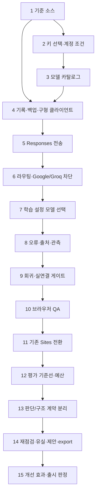

# OpenAI API 전환·모델 선택·판단 개선 실행 계획

작성/공식 문서 확인: **2026-11-03 KST** · Task Master **0.43.1 / master**
상태: **2026-11-03 구현 착수 승인**. 아래 표의 pending/deferred는 최초 계획 시점이다. 현재 상태는 Task Master와 [구현 기록](OPENAI_API_MIGRATION_IMPLEMENTATION.md)을 따른다. 제한된 합성 연결 검증(총 3회·모델당 1회·출력 4,096토큰·세전 US$0.50 이내)을 승인받았으며, 대규모 판단 평가는 별도 승인 전 실행하지 않는다.

## 1. 목표와 실행 범위

1. 오늘 학습의 문장 만들기와 문법 쓰기의 신규 AI 요청을 OpenAI API로 전환한다.
2. 학습 설정에서 사용자가 모델을 선택하고 계정별로 저장할 수 있게 한다.
3. Google·Groq의 새 호출과 자동 대체를 중지한다. 과거 결과·평가 원장·오프라인 재생은 보존한다.
4. 기존 기록·백업·전체/분할 복원·revision 충돌·첫 답·성적·한국 날짜를 보존한다.
5. 전환이 검증된 다음, 판단 개선을 별도 기준선·버전·고정 평가로 진행한다.

사용자의 새 요구는 기존 AGENTS.md의 Google 우선/Groq 대체 규칙을 이 작업에서 대체한다. 나머지 안전·호환성 지침은 유지한다. Task Master 관리 설정의 모델과 하루단어의 학습 모델 선택은 서로 다른 설정이다.

## 2. 근거 소스와 작업 위치

- 기본 작업/Task Master 루트: `C:/Users/user/Documents/ChatGPT/하루단어`.
- 운영 조회 결과: 기존 Site v141. 정확한 게시 소스 `3fe640c50cabd12519fc7490361e84b1ad72aed8`, tree `138158efe7e6f0aed9bb18cfca0172a9e27efc5e`.
- 현재 기본 폴더는 `codex/card-automation-topic-alignment@429d966`이며 기존 미커밋 변경을 포함한 구버전이다. 그대로 구현·재게시하지 않는다.
- 구현 시 Task 1에서 현재 Sites/GitHub 상태를 다시 확인하고 `codex/` 브랜치의 올바른 기준을 준비한다. 기존 변경은 덮어쓰지 않는다.
- 이번 감사 기준 자료: [검토 보고서](C:/Users/user/Documents/ChatGPT/하루단어/outputs/sentence-feedback-audit-2026-11-03/REPORT.md). 단위 658개/관련 브라우저 16개 성공은 **과거 기준선**이며 구현 후의 검증 증거로 재사용하지 않는다.
- 런타임 React/TypeScript·Vinext·Workers·D1·npm/lockfile을 유지한다. 새 Site·사이트/DB/R2 바인딩·접근 범위 변경은 없다.

주요 변경 경계는 v141 기준 `app/api/sentence-feedback/route.ts`, `app/api/grammar-feedback/route.ts`, `lib/feedback-fallback.ts`, `lib/grammar/feedback.ts`, `lib/provider-feedback-contract.ts`, `lib/sentence-feedback.ts`, `lib/learning/feedback-identity.ts`, `lib/state-shape.ts`, `app/learning/settings-dialog.tsx`, `lib/learning-api.ts`, `db/learning-state.ts`, 상태/전체·분할 복원·내보내기 및 관련 검사다.

## 3. 확정한 설계 방향

| 구분 | 계획 결정 |
|---|---|
| API | Workers 서버에서 OpenAI Responses API 호출. 기존 fetch 패턴을 사용하고 기본적으로 SDK 의존성을 추가하지 않음 [S01] |
| 키 | 서버 전용 Secret/승인한 ignored 파일. 사용자 모델 선택 UI에 키 입력란을 만들지 않음 |
| 선행 절차 | 구현 전 키 재사용/신규 생성과 저장 목적지를 사용자에게 확인. 이번 문서 작성에는 키가 필요하지 않음 [S17] |
| 요청 | `text.format`의 strict JSON Schema, `store:false`, 도구 없음, 자동 재전송/모델 대체 없음 [S01/S02/S15] |
| 모델 | 서버 허용 목록만 사용. `settings.aiModelId`는 계정별 선택 필드 |
| 비용 의도 | 새 POST의 `expectedModelId`를 일관되게 읽은 서버 선택과 비교. 다르면 upstream 호출 전 409 |
| 요청 중 변경 | 모델 선택을 잠그고 요청 시작 시 모델을 고정. 다른 기기의 변경을 기존 응답에 소급 적용하지 않음 |
| 메타데이터 | 새 의견에 provider·requestedModel·실제 model·promptVersion·validationVersion·createdAt를 보존 |
| 1차 판단 계약 | 기존 프롬프트 의미·판정 enum·필수 structure wire 계약을 고정. 숨긴 구조의 결합 문제는 기준선 확보 후 Task 13에서 변경 |
| 시간/크기 | 초기 upstream 28초, client AI 35초, 후속 저장 25초. 4,096 출력 토큰, 응답 256KiB, 최종 텍스트 30,000자와 기존 필드 한도 |
| 읽기·생성 분리 | 현재 요청 허용 모델과 과거 기록에서 읽는 모델을 분리. 현재 비활성인 과거 모델도 기록·복원은 지원 |
| 기본 호출 원칙 | 설정 열기·모델 변경·기록 조회·복원만으로 AI를 호출하지 않음 |

상한·버전 헤더 등은 이 프로젝트의 설계 결정이며 OpenAI가 요구하는 고정값이 아니다. 특히 추론 토큰도 출력 예산에 영향을 줄 수 있고, 28초/4,096토큰이 모든 모델의 성공을 보장하지 않는다. 제한된 실연결 결과가 기준에 맞지 않으면 후보를 활성화하지 않고 예산·지연 정책을 다시 검토한다.

## 4. 초기 모델 후보

공식 문서상 세 모델은 Responses와 structured outputs를 지원한다. 이는 사용자 API 계정의 이용 권한 확인을 대신하지 않는다 [S06/S07/S08].

| 모델 | 역할 | 입력 / 100만 토큰 | 출력 / 100만 토큰 |
|---|---|---:|---:|
| `gpt-6.1-sol` | 기본 후보 | $2 | $10 |
| `gpt-6.1-terra` | 선택 후보 | $1 | $5 |
| `gpt-6-astra` | 선택 후보 | $10 | $50 |

가격은 **2026-11-03 확인한 Standard·단기 문맥 단가**다. 캐시·장문·다른 처리 등급·세금·크레딧 등을 반영한 실제 청구액과 구분한다 [S09]. UI에는 확인일과 비용 차이를 안내한다.

초기 공통 reasoning은 `low`를 후보로 삼고 `temperature/top_p`는 보내지 않는다. Sol/Astra에 `none`을 보내지 않는다 [S10/S16]. 최종 기본값은 Sol 후보이며, 계정에서 사용할 수 없다면 다른 모델을 자동 선택하지 않는다. 실제 사용 가능·지원 계약·초기 지연 검증을 통과한 모델만 선택 목록에 활성화한다.

## 5. 호환성 설계의 핵심

### 설정과 새 의견

- `aiModelId`가 없는 과거 설정은 읽기/요청 시 기본값으로 해석한다. 조회만으로 과거 설정을 재저장하거나 revision을 올리지 않는다.
- 과거 Google/Groq 의견의 model·원문·교정·설명·structure·날짜는 변환하지 않는다.
- 저장용 모델 스키마는 현재 카탈로그와 분리한다. 신규 생성만 허용 목록으로 통제하고, 과거/향후 모델의 유한 길이 모델 문자열과 명시적 provider는 기록으로 읽는다.
- 새 출력의 실제 모델을 확인하고 요청 모델과 함께 남긴다. 알 수 없는 반환 모델을 선택한 모델이라고 위장하지 않는다.
- 모델 변경은 과거 의견의 재생성·재채점·성적 변경을 일으키지 않는다.

### 구형 클라이언트

계획한 새 capability는 **`X-Study-AI-Contract: 2`**다. GET/PUT/AI/전체·분할 복원에서 일관되게 사용한다.

새 설정이나 OpenAI 결과를 지원하지 않는 이전 화면에는 426과 백업/새로고침 안내를 제공한다. 구형 GET에서 새 결과를 제거해 성공처럼 응답하거나, 구형 설정 PUT으로 `aiModelId`를 삭제하게 하지 않는다. 기존 구조·문법·뜻 키 capability와 revision 보호도 유지한다.

### 백업과 DB

`haru-words-v1` envelope 및 기존 누적 byte/count 한도를 유지하고, 구형·신형·혼합 기록을 전체/분할 복원으로 왕복한다. 기존 409·원자 D1 batch·복원 commit 영수증/응답 유실 보호를 유지한다. 최초 OpenAI 전환에는 DB 테이블 마이그레이션이 필요하지 않았다. Task14.2의 요청 중복 방지/응답 유실 복구에는 별도 `0006_feedback_request_receipts`를 추가한다. 학습 데이터 backfill 없이24시간 응답/7일 tombstone과 소유권·복원 무효화를 구현하고, 로컬 적용·원자 실패·호환 reader 롤백을 검증한다. 상세 현재 절차는 후보 checkout의 `docs/FEEDBACK_REQUEST_RECEIPTS.md`이며 운영 적용 전 Task15 gate를 따른다. 기존 migration/학습 envelope는 변경하지 않는다.

## 6. 전송·오류·개인정보

- raw REST에서는 `output` 배열의 message/output_text를 해석한다. reasoning item·refusal·incomplete를 먼저 구별하고, SDK 전용 helper를 REST 응답 필드로 가정하지 않는다 [S01/S02].
- 실패·시간 초과·응답 유실 후 제공자가 실제 처리했는지는 불명확할 수 있다. 자동 재전송이나 고가 모델 대체를 하지 않는다.
- 429만으로 결제 부족·분당·일일 한도를 추정하지 않는다. 허용된 제공자 code와 Retry-After만 사용한다. 계정/결제/한도 설정을 자동 변경하지 않는다 [S04/S05].
- 새 학습 요청에는 문장과 필요한 목표 정보만 보낸다. 사용자 ID·이메일·전체 학습 이력·API 키를 모델 입력에 넣지 않는다.
- `store:false`는 response application state 저장을 제어하며, 제로 보관이나 abuse monitoring 미보관을 보장하지 않는다. 현재 OpenAI 데이터 문서의 기본 학습 미사용과 별도의 보관·승인 조건을 정확하게 안내한다 [S03].
- 로그는 고정 오류/검증 단계·모델·시간·토큰 수·비식별 요청 ID만 허용한다. 원문·AI 원문·개인 답변·키·제공자 raw 오류 본문은 남기지 않는다.
- 과거 출처는 Google/Groq, 새 출처는 OpenAI로 구별한다. 기존 CSV 열·수식 이스케이프·원본 백업을 보존한다.

## 7. Google·Groq 중지의 범위와 게시 순서

중지는 새 학습 API에만 한정하지 않는다. 공통 fallback·문법 helper·기존 평가 API·실호출 CLI·production import graph·환경 플래그까지 대조한다. legacy 키/토큰/플래그가 남거나 복구되어도 두 도메인으로 요청하지 않아야 한다. 고정 평가 데이터·기존 파서·오프라인 재생은 보존한다.

새 `ai_feedback_enabled`를 전체 AI 스위치로 사용하고 `google_ai_enabled`에 의존하지 않는다. 게시 순서는 다음과 같다.

1. 최종 로컬 검사와 호환성·복구 증거를 확보한다.
2. 기존 Site의 source helper·저장 버전·게시 절차를 사용한다. 새 AI와 legacy AI를 모두 끈 환경에서 검증 소스를 먼저 적용한다.
3. 적용 코드의 legacy 차단·reader/backup 호환성을 확인한다.
4. 승인 범위에서 확인된 모델이 최소 1개 있을 때 OpenAI만 활성화한다.
5. 장애 시 새 reader/backup 지원은 남기고 `ai_feedback_enabled=false`로 전체 새 호출을 차단한다.

새 OpenAI 기록이 생긴 뒤에는 v141처럼 해당 모델을 모르는 버전으로 단순 롤백하지 않는다. Google/Groq 재활성화도 롤백 기본 동작에 넣지 않는다. 이번 계획 작성은 위 운영 작업을 실행할 권한으로 해석하지 않는다.

## 8. 단계별 검증 게이트

| 게이트 | 통과 조건 |
|---|---|
| G0 · 구현 준비 | 올바른 소스와 사용자 자격 증명 선택/보관 목적지 확정. 이후에 API 코드 구현 시작 |
| G1 · 로컬 전환 | 모델 선택·혼합 기록·전체/분할 복원·409/426·legacy 호출 0·최종 단위/타입/린트/빌드/브라우저 통과 |
| G2 · OpenAI 활성화 | G1 + 활성 모델 최소 1개의 승인된 실연결·환경/바인딩/소스 대조·호환 롤백 절차 |
| G3 · 판단 개선 착수 | 전환 이후 고정 fixture/holdout·품질 기준·요청 버전·실제 평가 예산/승인 동결 |
| G4 · 판단 개선 활성화 | 새 고정 평가와 최종 회귀 통과. 실패·미실측이면 후보 비활성 유지 |

실연결 확인은 **활성 후보당 합성 요청 1회 이하, 합계 3회 이하**를 제안한다. 키 사용/실제 호출에 대한 별도 동의가 없으면 실행하지 않고 미실측으로 남긴다. 이는 제품의 임의 일일 제한이 아니다. 대규모 영어 평가는 G3의 별도 예산을 사용한다.

## 9. Task Master 실행 작업

상위 **15개**, 세부 **35개**. 전환 1~11은 pending, 판단 개선 12~15는 deferred다. 상세 구현·검사 기준은 Task Master 작업 본문을 기준으로 함께 관리한다.

| ID | 단계 | 작업 | 선행 ID | 상태 | 세부 수 |
|---:|---|---|---|---|---:|
| 1 | 전환 | 전환 기준 소스·호출 경계·불변 조건 고정 | 없음 | pending | 2 |
| 2 | 전환 | OpenAI 자격 증명·계정 이용 조건 확인 | 1 | pending | 2 |
| 3 | 전환 | 허용 모델 카탈로그·선택 정책 확정 | 2 | pending | 2 |
| 4 | 전환 | 설정·AI 결과·백업의 버전 호환 계약 구현 | 1, 3 | pending | 4 |
| 5 | 전환 | Workers용 OpenAI Responses 전송 어댑터 구현 | 2, 3, 4 | pending | 3 |
| 6 | 전환 | 단어·문법 요청 전환과 Google·Groq 실행 경로 차단 | 4, 5 | pending | 2 |
| 7 | 전환 | 학습 설정의 계정별 AI 모델 선택 UI 구현 | 3, 4, 6 | pending | 2 |
| 8 | 전환 | OpenAI 오류·개인정보·출처·관측 안내 정합화 | 5, 6, 7 | pending | 2 |
| 9 | 전환 | 전환·호환성·차단 회귀 검사와 제한된 실호출 게이트 | 4, 5, 6, 7, 8 | pending | 3 |
| 10 | 전환 | 로컬 Chromium·WebKit 모델 선택 전체 흐름 QA | 9 | pending | 2 |
| 11 | 전환 | 기존 Sites 전환 게시·관측·호환 롤백 준비 | 10 | pending | 3 |
| 12 | 판단 개선 | 전환 후 영어 판단 평가 기준선·호출 예산 확정 | 11 | deferred | 2 |
| 13 | 판단 개선 | 판단 전용 응답 계약과 숨긴 구조 의존성 분리 | 12 | deferred | 2 |
| 14 | 판단 개선 | 명시적 재점검·초안·교정 적용·보류 내보내기 개선 | 12, 13 | deferred | 2 |
| 15 | 판단 개선 | 개선 후 독립 평가·회귀·출시 판정 | 13, 14 | deferred | 2 |



도식은 핵심 진행 순서다. 모든 직접 의존성은 `.taskmaster/tasks/tasks.json`에 있다. 구현을 한 번도 시작하지 않았으므로 작업을 done으로 표시하지 않는다.

## 10. 요구사항 추적표

| ID | 요구사항 | Task Master ID |
|---|---|---|
| R01 | 새 단어·문법 AI 요청은 OpenAI Responses만 사용 | 5, 6, 9, 10, 11 |
| R02 | Google·Groq 학습/평가/CLI 실행 차단과 호출 0 검증 | 1, 6, 9, 11 |
| R03 | 학습 설정 모델 선택·계정별 저장·다음 요청 적용 | 3, 7, 10 |
| R04 | Google/Groq/구형/신형/혼합 기록과 출처 보존 | 4, 8, 9, 10, 11 |
| R05 | 서버 허용 목록·expectedModelId·요청 모델 고정·자동 대체 금지 | 3, 4, 5, 6, 7, 9 |
| R06 | 초안·성적·첫 답·한국 날짜·revision 충돌 보호 유지 | 4, 7, 9, 10, 11 |
| R07 | 전체·분할 백업/복원 한도·원자성·응답 유실 보호 | 4, 9, 10, 11 |
| R08 | 새 설정/모델을 모르는 구형 클라이언트 426 보호 | 4, 6, 7, 9, 10 |
| R09 | 출처·모델/프롬프트/검증 버전·안전 오류·관측 | 4, 5, 8, 9 |
| R10 | 기존 Sites ID/DB/R2/공개 범위와 npm/lockfile 유지 | 1, 6, 9, 11 |
| R11 | 명시적 요청만 실행·재시도/기록 읽기/모델 변경 자동 호출 금지 | 6, 7, 8, 9, 10, 11 |
| R12 | 서버 전용 키·사용자 자격 증명 선택·비용/개인정보 안내 | 2, 3, 5, 7, 8, 9, 11 |
| R13 | 전환 완료 후 기준선·고정 평가·버전별 판단 개선 | 12, 13, 15 |
| R14 | 감사에서 확인한 구조 의존성·재점검·유실·덮어쓰기·export의 후속 처리 | 12, 13, 14, 15 |

## 11. 구현 시 실행할 검사

| 구분 | 범위/예상 절차 |
|---|---|
| 실제 명령 확인 | 구현 checkout의 package.json과 tests/README.md부터 확인 |
| 단위·타입·린트 | 현재 정의 `npm test`, `npm run typecheck`, `npm run lint`; 변경 후 실제 출력과 exit 확인 |
| 공식 빌드 | 설치된 Sites `scripts/build-site.mjs` 절차 |
| adapter/route | 성공·refusal·incomplete·reasoning item·잘못된 JSON/모델·본문 한도·시간 초과·취소·401/403/429/5xx |
| legacy 차단 | key/env/token이 남은 학습·평가·CLI 경로, production graph 및 fetch spy에서 Google/Groq 0 |
| 모델 선택 | 계정 격리·재접속·다른 기기·선택 저장 실패/409·요청 중 변경·불가 모델·expectedModelId mismatch |
| 데이터 호환 | old/new/mixed word/grammar·설정 누락/비활성 모델·전체/분할 restore·원자 실패·영수증 유실·409/426 |
| 브라우저 | 기존 관련 QA + 모델 선택 QA, loopback/가상 계정, Chromium/WebKit·320/390/768/1440px·200%·키보드·axe |
| 문법 | 실제 생성/지원 v1~v4 프로필을 분리. 한 프로필 통과를 전체 버전 통과로 보고하지 않음 |
| 보존 | 첫 답·회상·친숙도·문장 상태·학습일·의견·교정 적용을 임의 합치거나 재채점하지 않음 |
| 게시 | 검증 소스/아카이브·환경 revision·바인딩/접근·호환 rollback을 기록 |

운영 학습 기록을 QA로 수정하지 않는다. WebKit 결과는 실제 iPhone/VoiceOver 검사와 구분한다. 기존 검사가 새 계약을 다루는지 확인하고, 단지 기존 658개를 통과했다는 이유로 새 모델 호환이 완료되었다고 하지 않는다.

## 12. 판단 개선의 범위

전환 이후 기존 평가 원장·17개 실패·과거 점수를 동결한 상태에서 뜻/목표, 원문 문법, 교정 의미 보존, 설명 정확성, 판단 보류를 분리해 평가한다. 새 모델 평가와 앱의 유실/덮어쓰기/내보내기 오류 수정을 섞어 개선율을 설명하지 않는다 [S11].

제안 gate는 **핵심 의미 반전·비문 승인 0, 종합 90% 이상, 기준 대비 악화 0**이다. 실제 사례 수·허용 대안·정상 거절률·모델별 지연·비용·호출 상한은 실행 전에 고정하고 승인받는다. 기존 480회 승인이나 성공률은 새 호출 허가가 아니다.

숨긴 구조의 필수 생성 제거는 기존 안전 검사 대체·정상 대조군을 확보한 뒤 수행한다. 같은 문장 재점검, 초안 내구화, 과거 제안 비교/되돌리기, 보류 CSV/tutor export, 요청 멱등성/결과 복구·집계 쓰기 실패 정책은 Task 14에서 다룬다. 원문 추가 저장·DB 테이블이 필요해지면 개인정보·보관/삭제·마이그레이션/롤백부터 갱신한다.

## 13. 위험과 복구

| 위험 | 대응 |
|---|---|
| 현재 폴더가 구버전 | Task 1에서 게시 소스/main 대조 후 올바른 base; 기존 미커밋 변경 보존 |
| 구형 설정 PUT이 모델 선택 삭제 | 새 capability·426·혼합/구형 클라이언트 회귀 |
| 새 모델로 과거 백업 읽기 실패 | 저장 모델과 생성 허용 목록 분리·full/chunk 왕복 |
| 느린 추론·출력 토큰 부족 | 모델별 실연결/지연·incomplete 처리; 다른 모델 자동 전환 금지 |
| API 중복 과금/처리 불명 | raw fetch 단일 요청·수동 재시도·비식별 진단; timeout 뒤 사용량 확정 금지 |
| 기존 평가 도구로 legacy 호출 재개 | key/env/token 존재 상태에서도 legacy 실행 경로 차단 |
| 새 기록 뒤 구형 코드 롤백 | 새 reader/restore 지원 유지 + AI master off |
| 구조 제거로 안전 보류 사라짐 | Task 13의 대체 검증과 기준선 뒤에만 계약 변경 |

운영 변경 때 보고할 항목은 위험도·호환성·롤백·관측 영향·마이그레이션·미검증 범위다. 현재 계획 단계의 운영 영향은 없다.

## 14. Task Master 사용과 현재 계획의 완료 기준

Task Master 루트는 기본 폴더, tag는 `master`다. MCP `get_tasks/get_task/next_task`로 현재 순서와 본문을 확인한다. CLI가 정상 동작하는 환경에서는 다음 명령도 사용할 수 있다 [S12/S13].

```powershell
task-master list --with-subtasks
task-master show 1
task-master next
task-master validate-dependencies
node .taskmaster/scripts/validate-openai-migration-plan.mjs
```

판단 개선 12~15는 G2 이후 해당 작업의 선행 조건을 확인하고 pending으로 전환한다. 실패·승인 대기는 관련 구현 작업에 명시하되 작업을 done으로 바꾸지 않는다. Task Master의 자동 PRD 분석/연구 호출은 이번에 실행하지 않고, 확인한 요구사항을 수동 필드로 등록했다.

**이번 계획 산출물의 완료 기준:** 15/35 등록·상태/의존성 무결성·R01~R14 추적·공식 근거 연결·검증/복구 게이트·계획 validator 통과·보호 파일 해시 불변. 이는 구현·운영 전환 완료 기준과 다르다.

## 15. 공식 문서·설치 스킬 근거

다음 자료를 이번 작업에서 직접 열어 확인했다. 모델·가격·정책은 구현 직전에 다시 확인한다. API reference 특정 페이지가 본문 없이 반환된 경우는 근거에 포함하지 않았고, Responses 전환 안내·공식 예시·모델별 문서로 계약을 확인했다.

- **S01** [Responses 전환 안내](https://developers.openai.com/api/docs/guides/migrate-to-responses)
- **S02** [Structured Outputs](https://developers.openai.com/api/docs/guides/structured-outputs)
- **S03** [API 데이터 처리·보관](https://developers.openai.com/api/docs/guides/your-data)
- **S04** [API 오류 코드](https://developers.openai.com/api/docs/guides/error-codes)
- **S05** [Rate limits](https://developers.openai.com/api/docs/guides/rate-limits)
- **S06** [GPT-6.1 Sol](https://developers.openai.com/api/docs/models/gpt-6.1-sol)
- **S07** [GPT-6.1 Terra](https://developers.openai.com/api/docs/models/gpt-6.1-terra)
- **S08** [GPT-6 Astra](https://developers.openai.com/api/docs/models/gpt-6-astra)
- **S09** [API 가격](https://developers.openai.com/api/docs/pricing)
- **S10** [GPT-6 계열 안내](https://developers.openai.com/api/docs/guides/latest-model)
- **S11** [평가 모범 사례](https://developers.openai.com/api/docs/guides/evaluation-best-practices)
- **S12** [Task Master 작업 구조](https://raw.githubusercontent.com/eyaltoledano/claude-task-master/main/docs/task-structure.md)
- **S13** [Task Master 명령](https://raw.githubusercontent.com/eyaltoledano/claude-task-master/main/docs/command-reference.md)
- **S14** [설치된 Sites 스킬](C:/Users/user/.codex/plugins/cache/openai-curated-remote/sites/1.1.2/skills/sites/SKILL.md)
- **S15** [Responses 요청·재시도 예시](https://developers.openai.com/cookbook/articles/per_run_spending_controller_responses_api)
- **S16** [GPT-6 migration quickstart](https://developers.openai.com/api/docs/guides/latest-model/gpt-6-astra.md#migration-quickstart)
- **S17** [설치된 OpenAI API Key 스킬](C:/Users/user/.codex/plugins/cache/openai-curated-remote/openai-developers/1.3.13/skills/openai-platform-api-key/SKILL.md)

## 16. 이번 계획의 검증 기록

- Task Master MCP에서 상위 15개·세부 35개를 다시 읽었다. 전환 작업 11개는 pending, 후속 판단 개선 4개는 deferred이며 완료로 표시한 구현 작업은 없다.
- MCP next_task가 반환한 다음 작업은 #1이다.
- 계획 전용 validator의 초기 snapshot 모드에서 368개 검사 통과·exit 0을 확인했다. 요구사항 14개·출처 17개·의존성·순환 참조·초기 상태와 보호 파일 해시를 대조한다.
- CLI 명령은 사용 예시다. 이 환경의 CLI는 출력이 없어 작업 조회 증거로 사용하지 않았고, 실제 등록/조회 증거는 MCP 및 JSON 검증 결과를 사용한다.
- 제품 코드·운영 설정·키를 변경하지 않아 제품 단위/타입/린트/빌드와 실제 AI 호출은 이번 계획 작성에서 실행하지 않았다. 해당 검사는 구현 후 Task 9~11에서 수행한다.
